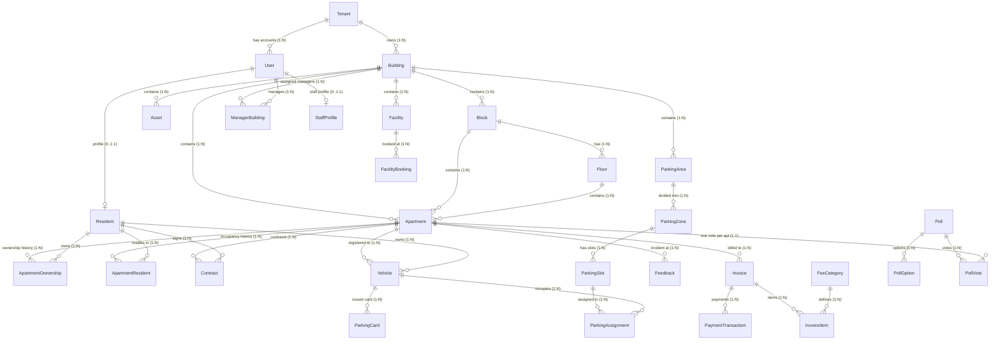

# K-Home — Kiểm Toán Database & Domain Model (Database & Domain Audit)

> **Tài liệu:** Đánh giá Chi tiết Mô hình Dữ liệu, Thực thể, Quan hệ và Ràng buộc Toàn vẹn  
> **Schema Phân tích:** `prisma/schema.prisma` (1.512 dòng, 26 models, 25 enums)  
> **Migrations Thực tế:** 6 migrations từ `0_init` đến `20261016220000_add_multi_tenant_core`  

---

## 1. Sơ Đồ Thực Thể Quan Hệ Tổng Thể (Mermaid ERD)



---

## 2. Kiểm Toán Phân Cấp Bất Động Sản (Property Hierarchy)

### 2.1. Chuỗi Phân Cấp: `Tenant` → `Building` → `Block` → `Floor` → `Apartment`

Codebase hiện tại hỗ trợ cả hai mô hình:
1. **Mô hình Chuẩn mới:** `Building` (Tòa nhà) → `Block` (Khối/Tháp) → `Floor` (Tầng) → `Apartment` (Căn hộ).
2. **Cột Di sản Tương thích ngược:** Cột `building String` (VD: "Tòa A") và `floor Int` (VD: 10) nằm trực tiếp trên model `Apartment`.

```prisma
model Apartment {
  id        String          @id @default(cuid())
  code      String          @unique // e.g. "A-1001"
  building  String // e.g. "Tòa A" (backward-compatible)
  floor     Int    // e.g. 10 (backward-compatible)
  ...
  buildingId  String?
  buildingRef Building?     @relation(fields: [buildingId], references: [id], onDelete: SetNull)
  blockId     String?
  block       Block?        @relation(fields: [blockId], references: [id], onDelete: SetNull)
  floorId     String?
  floorRef    Floor?        @relation(fields: [floorId], references: [id], onDelete: SetNull)
}
```

### 2.2. Điểm Bất Cập Cốt Lõi Được Phát Hiện:
1. **`Apartment.code @unique` là duy nhất TOÀN CẦU:**
   - Trong một hệ sinh thái chung cư nhiều tòa hoặc nhiều tổ hợp (Multi-Tenant), số phòng căn hộ luôn lặp lại (VD: Tòa Landmark 1 có căn `1001`, Tòa Landmark 2 cũng có căn `1001`).
   - Ràng buộc `@unique` toàn bảng khiến việc nhập căn hộ cho tòa nhà thứ hai hoặc tổ hợp thứ hai bị văng lỗi cơ sở dữ liệu `Unique constraint failed on the fields: (code)`.
   - **Cách sửa chuẩn:** Thay `@unique` trên `code` bằng `@@unique([buildingId, code])`.
2. **`buildingId`, `blockId`, `floorId` bị để `nullable` (`String?`):**
   - Ràng buộc lỏng lẻo này cho phép tạo ra các căn hộ "mồ côi" (Orphaned Apartments) không thuộc bất kỳ tòa nhà nào.
   - Khi căn hộ không có `buildingId`, các hàm kiểm tra phân quyền (`authorizeApartmentAccess`) không thể xác định tòa nhà và mặc định cấp quyền truy cập (`allowed: true`), tạo ra lỗ hổng bỏ qua phân quyền.
3. **Dữ liệu dư thừa không đồng bộ:**
   - Trường `building String` và `floor Int` lưu song song với `buildingRef.name` và `floorRef.floorNumber`. Khi quản trị viên đổi tên Block/Building, cột text cũ trên `Apartment` không được cập nhật tự động.

---

## 3. Kiểm Toán Mô Hình Con Người & Quan Hệ Cư Trú (Human & Residency Domain)

Codebase đã thực hiện một bước chuyển đổi kiến trúc lớn thông qua migration `20261012224000_add_apartment_ownership_residency_payment` và `20261013210000_remove_resident_legacy_columns`:

| Khái niệm | Model Thực Tế | Mô tả & Trách nhiệm dữ liệu chuẩn |
|---|---|---|
| **Tài khoản Đăng nhập** | `User` | Chứa email, passwordHash, role, tenantId, số điện thoại đăng nhập, trạng thái hoạt động. |
| **Hồ sơ Pháp lý Cư dân** | `Resident` | Chứa thông tin nhân thân định danh: CCCD (`identityCard @unique`), họ tên, ngày sinh, giới tính. **Không chứa khóa ngoại căn hộ.** |
| **Quan hệ Sở hữu Căn hộ** | `ApartmentOwnership` | Quản lý việc chủ căn hộ sở hữu bất động sản: số sổ hồng (`certificateNumber`), tỷ lệ sở hữu (`ownershipPercentage`), ngày bắt đầu/kết thúc, cờ `isCurrent: true`. Hỗ trợ đồng sở hữu (Co-owner) và chủ sở hữu là tổ chức (Corporate). |
| **Quan hệ Cư trú Thực tế** | `ApartmentResident` | Quản lý việc ai đang thực tế sinh sống tại căn hộ: vai trò (`HEAD_OF_HOUSEHOLD`, `FAMILY_MEMBER`, `TENANT`, `TEMPORARY`), cờ `isLivingHere: true`, thời gian cư trú. Ràng buộc `@@unique([apartmentId, residentId, startDate])`. |
| **Hợp đồng Thuê / Mua** | `Contract` | Quản lý hợp đồng pháp lý ký kết giữa Ban quản lý và Cư dân đối với một căn hộ cụ thể. |

### Đánh giá chất lượng:
- **Đạt chuẩn xuất sắc:** Không còn tình trạng xem "Chủ sở hữu" bắt buộc phải "ở tại căn hộ". Một chủ nhà (`Resident`) có thể sở hữu 3 căn hộ thông qua 3 bản ghi `ApartmentOwnership`, trong khi đang cư trú tại 1 căn hộ khác qua `ApartmentResident`.
- **Rủi ro còn tồn đọng:** Mặc dù database đã chuẩn hóa, một số integration test cũ (`tests/backend-security.test.ts`) vẫn mock dữ liệu giả định `Resident.apartmentId` tồn tại trực tiếp, dẫn đến test fail.

---

## 4. Kiểm Toán Multi-Tenant Scope & Đường Dẫn Dữ Liệu (Multi-Tenant Scoping)

Mô hình phân cấp nghiệp vụ mong muốn:
$$\text{Platform Admin} \longrightarrow \text{Tenant (Khách hàng/Tổ hợp)} \longrightarrow \text{Building} \longrightarrow \text{Block} \longrightarrow \text{Floor} \longrightarrow \text{Apartment}$$

Đối chiếu với thực tế Schema và Database:

| Model | Thuộc tính Scope | Đường dẫn truy xuất Tenant Scope | Nhận định rủi ro |
|---|---|---|---|
| `Tenant` | `id` | Thực thể gốc | Chuẩn |
| `Building` | `tenantId String?` | `Building.tenantId` | Hầu hết đã có `tenantId`, nhưng vẫn là `nullable` trong schema |
| `User` | `tenantId String?` | `User.tenantId` | `PLATFORM_ADMIN` có `tenantId: null` (đúng). `TENANT_ADMIN` và `MANAGER` bắt buộc phải có `tenantId`. |
| `ManagerBuilding` | `managerId`, `buildingId` | `ManagerBuilding.building.tenantId` | Bảng phân công Manager quản lý tòa nhà cụ thể (`@@unique([managerId, buildingId])`) |
| `Block` | `buildingId String` | `Block.building.tenantId` | Gián tiếp qua Building |
| `Floor` | `blockId String` | `Floor.block.building.tenantId` | Gián tiếp qua Block |
| `Apartment` | `buildingId String?` | `Apartment.buildingRef.tenantId` | **Rủi ro:** Khi `buildingId` bị null, căn hộ trôi dạt ra ngoài Tenant Scope |
| `FeeCategory` | **Không có** | **Toàn cục (Global)** | **Rủi ro P1:** Mọi Tenant dùng chung 1 bảng phí. Không thể cấu hình đơn giá điện, nước, phí quản lý riêng cho từng tổ hợp |
| `Invoice` | `apartmentId String` | `Invoice.apartment.buildingRef.tenantId` | Gián tiếp qua Apartment |
| `PaymentTransaction` | `invoiceId String` | `PaymentTransaction.invoice.apartment...` | Gián tiếp qua Invoice |
| `Vehicle` | `apartmentId String` | `Vehicle.apartment.buildingRef.tenantId` | Gián tiếp qua Apartment |
| `ParkingArea` | `buildingId String` | `ParkingArea.building.tenantId` | Trực tiếp qua Building |
| `ParkingSlot` | `areaId String` | `ParkingSlot.area.building.tenantId` | Gián tiếp qua ParkingArea |
| `Facility` | `buildingId String?` | `Facility.building.tenantId` | `buildingId` là `nullable`. Tiện ích chung không có `buildingId` sẽ bị lộ ra toàn sàn |
| `Poll` | `createdById String` | **Không có liên kết Tenant/Building** | **Rủi ro P1:** Poll chỉ gắn với `User`. Cư dân Tenant A có thể nhìn thấy Poll của Tenant B |
| `VisitorPass` | `apartmentId String` | `VisitorPass.apartment.buildingRef.tenantId` | Gián tiếp qua Apartment |
| `ParcelDelivery` | `apartmentId String` | `ParcelDelivery.apartment.buildingRef.tenantId` | Gián tiếp qua Apartment |
| `Feedback` | `apartmentId String` | `Feedback.apartment.buildingRef.tenantId` | Gián tiếp qua Apartment |
| `AuditLog` | `actorId`, `entityId` | **Không có `tenantId` hay `buildingId`** | Không thể lọc nhật ký kiểm toán theo từng Tenant |

---

## 5. Kiểm Toán Bãi Đỗ Xe Thông Minh (Smart Parking Domain)

Mô hình dữ liệu bãi xe được thiết kế rất chi tiết:
- `ParkingArea`: Khu vực bãi xe (VD: Tầng hầm B1, Tầng hầm B2, Bãi ngoài trời), gắn với `buildingId`.
- `ParkingZone`: Phân khu chức năng (VD: Khu A - Ô tô, Khu B - Xe máy & EV), có `colorHex`, `vehicleType`.
- `ParkingSlot`: Vị trí đỗ xe cụ thể, có tọa độ `positionX`, `positionY`, `width`, `height` phục vụ vẽ bản đồ tương tác (Interactive Parking Map), trạng thái `status` (`AVAILABLE`, `OCCUPIED`, `RESERVED`, `MAINTENANCE`, `BLOCKED`, `INACTIVE`).
- `ParkingRegistrationRequest`: Đơn đăng ký gửi xe do cư dân tạo cho một phương tiện cụ thể.
- `ParkingAssignment`: Bản ghi cấp phát chỗ đỗ chính thức khi Manager duyệt đơn, có `monthlyFee`, mã `qrToken` độc nhất bảo mật.
- `ParkingAccessLog`: Lịch sử xe quét thẻ/nhận diện ra/vào tại các cổng barrier.

### Điểm đánh giá:
- **Ưu điểm:** Ràng buộc `vehicleId` kết nối chặt chẽ với `Apartment` và `Resident`. Ràng buộc `1 Xe -> Tối đa 1 Chỗ đỗ hoạt động` được kiểm tra chặt chẽ ở tầng service.
- **Vấn đề toàn vẹn:** Trường `qrToken` và `assignmentCode` trên `ParkingAssignment` đều là `@unique`. Tuy nhiên `assignmentCode` được sinh bằng `count() + 1`, tiềm ẩn lỗi trùng mã khi có 2 quản lý cùng duyệt đơn đồng thời.

---

## 6. Kiểm Toán Dữ Liệu Dư Thừa & Mô Hình IoT Đã Bị Loại Bỏ

### 6.1. Xác minh Module Giám sát Vận hành IoT:
- **Trạng thái thực tế trong Runtime Code (`src/`):** **Đã dọn dẹp sạch sẽ 100%.** Không còn API route, service, component hay import nào gọi đến thiết bị IoT thực tế hay giả lập.
- **Trạng thái còn sót lại trong Database Schema (`prisma/schema.prisma`):**
  - Enum `IoTSensorType` (dòng 1355) và `IoTSensorStatus` (dòng 1365).
  - Model `IoTSensor` (dòng 1372 - 1395).
  - Quan hệ `sensorId String?` và `sensor IoTSensor?` trên model `SmartAlertRecord` (dòng 1434 - 1435).
- **Hậu quả:** Schema cồng kềnh, gây hiểu lầm cho các kỹ sư mới rằng hệ thống vẫn duy trì kết nối IoT phần cứng.
- **Đề xuất khắc phục:** Xóa bỏ model `IoTSensor`, hai enum liên quan và trường `sensorId`/`sensor` trên `SmartAlertRecord` thông qua migration dọn dẹp an toàn.

---

## 7. Bảng Chi Tiết Các Phát Hiện Database (Database Findings)

### [DB-001] Ràng Buộc Mã Căn Hộ `@unique` Toàn Cục Gây Xung Đột Multi-Tenant / Multi-Building
- **Mức độ:** **P1** (Nghiêm trọng về mặt nghiệp vụ)
- **Model / Vị trí:** Model `Apartment`, trường `code String @unique` (`prisma/schema.prisma:407`).
- **Hiện tượng & Bằng chứng:**
  ```prisma
  model Apartment {
    id   String @id @default(cuid())
    code String @unique // e.g. "A-1001"
  ```
- **Hậu quả:** Không thể có hai căn hộ cùng tên (VD: `A-101`) ở hai tòa nhà khác nhau hoặc hai tổ hợp (Tenant) khác nhau. Khi Tenant 2 nhập danh sách căn hộ trùng mã với Tenant 1, Prisma ném lỗi `P2002 Unique constraint failed`.
- **Hướng khắc phục:**
  1. Đổi `code String @unique` thành `code String`.
  2. Bổ sung composite index: `@@unique([buildingId, code])`.
- **Module bị ảnh hưởng:** `apartment`, `tenant`, `building`.

---

### [DB-002] Khóa Ngoại `buildingId` Trên Căn Hộ Bị Để Nullable
- **Mức độ:** **P1** (Lỗ hổng phân quyền dữ liệu)
- **Model / Vị trí:** Model `Apartment`, trường `buildingId String?` (`prisma/schema.prisma:419`).
- **Hiện tượng & Bằng chứng:**
  `buildingId` được định nghĩa là tùy chọn (`String?`). Khi gọi API `POST /api/apartments`, nếu client không truyền `buildingId`, căn hộ vẫn được tạo thành công với `buildingId = null`.
- **Hậu quả:**
  - Căn hộ mồ côi không thuộc tòa nhà nào.
  - Khi kiểm tra quyền tại `authorizeApartmentAccess`, hàm `resolveApartmentBuildingId` trả về `null`. Code authorization có dòng:
    ```ts
    if (!buildingId) return { allowed: true };
    ```
    Dẫn đến mọi Manager của bất kỳ tòa nhà nào đều xem và sửa được căn hộ này!
- **Hướng khắc phục:** Chuyển `buildingId String` thành bắt buộc (`NOT NULL`). Viết migration backfill gắn toàn bộ căn hộ hiện có vào tòa nhà tương ứng.
- **Module bị ảnh hưởng:** `apartment`, `authorization`, `invoices`, `feedbacks`.

---

### [DB-003] `FeeCategory` Mang Tính Toàn Cục, Thiếu Scope Theo Tenant
- **Mức độ:** **P1** (Nghiêm trọng về mô hình nghiệp vụ tài chính)
- **Model / Vị trí:** Model `FeeCategory`, trường `code String @unique`, thiếu `tenantId` (`prisma/schema.prisma:532`).
- **Hiện tượng & Bằng chứng:**
  Bảng `fee_categories` chỉ có `code`, `name`, `unit`, `unitPrice`, không có `tenantId`.
- **Hậu quả:**
  - Mọi khách hàng/tổ hợp trên nền tảng K-Home buộc phải áp dụng cùng một đơn giá phí dịch vụ (VD: Phí quản lý `12.000 đ/m2`, Phí xe máy `100.000 đ/xe`).
  - Nếu Tổ hợp A muốn tăng phí gửi xe lên `150.000 đ`, thao tác này sẽ tự động thay đổi giá của Tổ hợp B và C trên toàn quốc!
- **Hướng khắc phục:**
  - Thêm trường `tenantId String?` vào `FeeCategory`.
  - Nếu `tenantId == null` và `isSystem == true`: Biểu phí mẫu mặc định của nền tảng K-Home.
  - Nếu `tenantId != null`: Biểu phí riêng của từng Tenant.
  - Chuyển `code @unique` thành `@@unique([tenantId, code])`.
- **Module bị ảnh hưởng:** `fee`, `invoice`, `billing`.

---

### [DB-004] Model `Poll` (Khảo Sát) Thiếu Ràng Buộc Tenant / Building
- **Mức độ:** **P1** (Rò rỉ dữ liệu giữa các tổ hợp)
- **Model / Vị trí:** Model `Poll` (`prisma/schema.prisma:1293`).
- **Hiện tượng & Bằng chứng:**
  Model `Poll` chỉ có `id`, `title`, `createdById`, `targetScope` (`ALL_APARTMENTS`, `BUILDING`, `BLOCK`, `FLOOR`, `SELECTED_APARTMENTS`). Hoàn toàn không có khóa ngoại `tenantId` hoặc `buildingId`.
- **Hậu quả:**
  - Khi Manager tạo Poll với `targetScope = ALL_APARTMENTS`, API query `pollRepository.findAll` không có điều kiện lọc theo Tenant, làm cho toàn bộ cư dân của các Tenant khác đều đọc được và tham gia bỏ phiếu.
  - Đồng thời, thông báo tạo Poll gửi đi với `isGlobal: true` bắn đến toàn bộ cư dân trên hệ thống.
- **Hướng khắc phục:** Bổ sung `tenantId String` và `buildingId String?` vào model `Poll`. Điều chỉnh query chỉ lấy Poll trong cùng Tenant/Building của cư dân.
- **Module bị ảnh hưởng:** `poll`, `notification`, `resident-portal`.

---

### [DB-005] Tồn Dư Model & Enum IoT Không Còn Sử Dụng (`IoTSensor`)
- **Mức độ:** **P2** (Dọn dẹp mã & Nợ kỹ thuật)
- **Model / Vị trí:** Model `IoTSensor` (`prisma/schema.prisma:1372`), enum `IoTSensorType`, enum `IoTSensorStatus`, và trường `SmartAlertRecord.sensorId`.
- **Hiện tượng & Bằng chứng:** Runtime code đã bỏ hoàn toàn tính năng cảm biến phần cứng IoT. Bảng `iot_sensors` nằm trơ trong database không có dữ liệu phát sinh.
- **Hậu quả:** Gây nhầm lẫn trong kiến trúc, chiếm tài nguyên metadata của PostgreSQL.
- **Hướng khắc phục:** Tạo migration xóa khóa ngoại `sensorId` trên `smart_alerts`, sau đó drop bảng `iot_sensors` và các enum liên quan.
- **Module bị ảnh hưởng:** `smart-operations`, `prisma/schema.prisma`.

---

### [DB-006] Thiếu Ràng Buộc Tenant Scope Trên `AuditLog`
- **Mức độ:** **P2** (Bảo mật thông tin kiểm toán)
- **Model / Vị trí:** Model `AuditLog` (`prisma/schema.prisma:718`).
- **Hiện tượng & Bằng chứng:**
  Model `AuditLog` chỉ ghi `actorId`, `actorEmail`, `actorRole`, `action`, `entity`, `entityId`. Không có cột `tenantId`.
- **Hậu quả:** Không thể phân quyền cho Customer Admin (Tenant Admin) chỉ xem nhật ký kiểm toán trong nội bộ tổ hợp của mình mà không can thiệp vào log của tổ hợp khác.
- **Hướng khắc phục:** Bổ sung trường `tenantId String?` vào model `AuditLog` và ghi nhận tự động trong `auditLogService.record`.
- **Module bị ảnh hưởng:** `audit`, `settings/access-control`.
