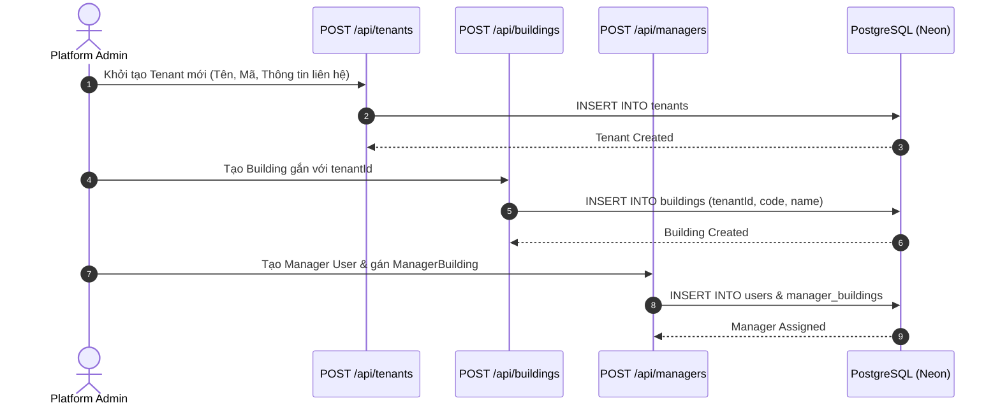
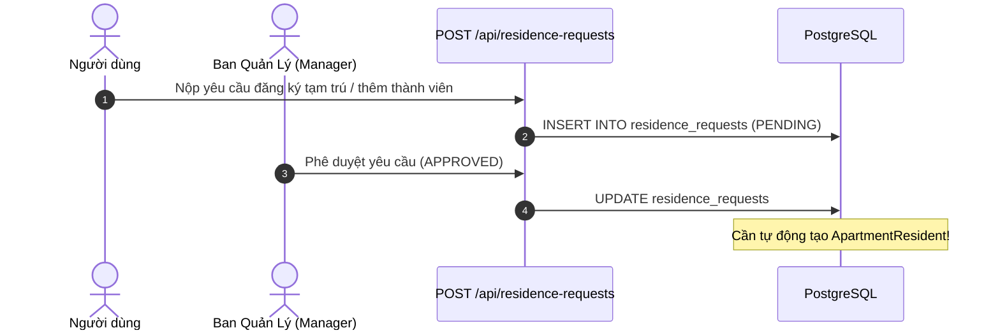
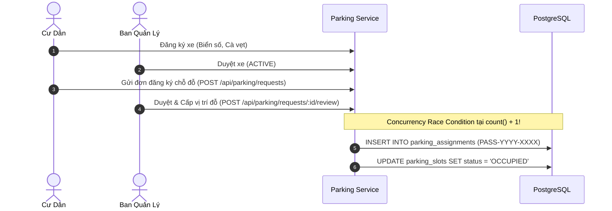
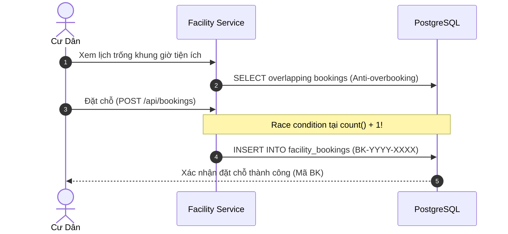
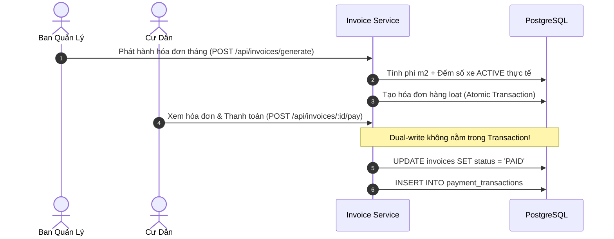

# K-Home — Kiểm Toán Quy Trình Nghiệp Vụ End-to-End (Feature & Workflow Audit)

> **Tài liệu:** Đánh giá Chi tiết 8 Quy trình Nghiệp vụ Cốt lõi, Mức độ Hoàn thiện và Các Điểm Đứt Gãy (Workflow Breakpoints)  
> **Nguyên tắc kiểm toán:** Kiểm tra theo kịch bản hành trình thực tế của người dùng (User Journeys), không chỉ kiểm tra endpoint riêng lẻ.  

---

## 1. Bảng Tổng Quan 8 Quy Trình Nghiệp Vụ Cốt Lõi

| Quy trình nghiệp vụ | Mức độ hoàn thiện | Điểm nghẽn chính | Trạng thái |
|---|:---:|---|:---:|
| **1. Onboarding Khách hàng & Phân công Quản lý** | **85%** | Thiếu liên kết Tenant trong `prisma/seed.ts`; tạo Building/Manager chạy tốt | 🟢 Khá tốt |
| **2. Tiếp nhận Nhân khẩu & Xác minh Cư trú** | **90%** | Mô hình tách `Ownership` & `Resident` hoàn chỉnh; thiếu UI duyệt tự động đăng ký tạm trú | 🟢 Rất tốt |
| **3. Bãi xe Thông minh & Cấp phát Chỗ đỗ** | **85%** | FSM duyệt đơn và tính phí động xuất sắc; **Race condition** sinh mã `PASS-...` khi đồng thời | 🟡 Cần xử lý Race |
| **4. Tiện ích & Đặt chỗ Trực tuyến** | **80%** | Khóa chống trùng chỗ thời gian thực tốt; **Race condition** sinh mã `BK-...`; thiếu check tòa nhà | 🟡 Cần xử lý Race |
| **5. Khảo sát Ý kiến & Biểu quyết Căn hộ** | **70%** | Khóa 1 căn hộ = 1 phiếu hoàn hảo; **Thiếu Tenant/Building Scoping** dẫn đến phát sóng toàn sàn | 🔴 Cần chặn Scope |
| **6. Khách thăm & Kiểm soát Ra vào QR** | **90%** | Sinh mã QR an toàn, bảo vệ quét mã check-in/check-out, audit log đầy đủ | 🟢 Hoàn chỉnh |
| **7. Bảo trì Định kỳ & Xử lý Sự cố Kỹ thuật** | **95%** | FSM chuyển trạng thái và tính toán SLA chuẩn mực; phân công kỹ thuật viên trơn tru | 🟢 Hoàn hảo |
| **8. Hóa đơn, Tính Cước Động & Gạch Nợ** | **85%** | Tự động quét số xe thực tế; **Thiếu Transaction nguyên tử** khi ghi `paymentTransaction` | 🟡 Cần bọc Transaction |

---

## 2. Kiểm Toán Chi Tiết Từng Quy Trình Nghiệp Vụ

---

### 2.1. Quy trình Onboarding Khách hàng & Phân quyền Quản trị (Tenant Onboarding)



- **Các bước đã có:**
  - `POST /api/tenants`: Platform Admin khởi tạo khách hàng tổ hợp.
  - `POST /api/buildings`: Chỉ định `tenantId` cho tòa nhà (bắt buộc đối với Platform Admin, tự động gán đối với Tenant Admin).
  - `POST /api/managers`: Gán tài khoản Manager và liên kết bảng phân công `manager_buildings`.
- **Bước còn thiếu & Điểm nghẽn:**
  - Quy trình hoàn hảo trên API, nhưng script khởi tạo dữ liệu mẫu chính `prisma/seed.ts` **chưa tích hợp việc tạo Tenant**. Dữ liệu mẫu chỉ được bổ sung qua file script lẻ `scripts/backfill-multi-tenant.ts`. Khi người mới chạy `npm run db:seed`, toàn bộ hệ thống quay về trạng thái không có Tenant.

---

### 2.2. Quy trình Cư Trú & Quan Hệ Nhân Khẩu (Residency & Household)



- **Các bước đã có:**
  - Phân tách `User` (tài khoản) và `Resident` (nhân khẩu CCCD).
  - Tách bạch `ApartmentOwnership` (sở hữu sổ đỏ/hồng) và `ApartmentResident` (cư trú thực tế: Chủ hộ, thành viên, người thuê).
  - API `GET /api/residents`: Hỗ trợ lọc theo `apartmentId`, `buildingId`, CCCD.
- **Bước còn thiếu & Điểm nghẽn:**
  - Endpoint `POST /api/residence-requests` nhận yêu cầu cư trú. Tuy nhiên, khi Ban Quản Lý duyệt yêu cầu (`APPROVED`), logic nghiệp vụ hiện tại **chưa tự động tạo bản ghi `ApartmentResident`** tương ứng trong transaction, mà quản lý vẫn phải thao tác thủ công thêm nhân khẩu vào căn hộ.

---

### 2.3. Quy trình Bãi Đỗ Xe & Cấp Phát Chỗ Đỗ (Smart Parking Workflow)



- **Các bước đã có:**
  - Quy tắc nghiêm ngặt: Phương tiện phải ở trạng thái `ACTIVE` mới được phép đăng ký chỗ đỗ.
  - Quy tắc `1 Xe -> Tối đa 1 Chỗ đỗ hoạt động` được kiểm tra chặt chẽ.
  - Cấp mã bảo mật `qrToken` ngẫu nhiên 24 ký tự hex độc nhất cho mỗi `ParkingAssignment`.
  - Cập nhật trạng thái chỗ đỗ sang `OCCUPIED` đồng thời khi duyệt đơn.
- **Bước còn thiếu & Điểm nghẽn (FLOW-001 - P1):**
  - **Race Condition sinh mã phân công:**
    ```ts
    const assignmentCount = await tx.parkingAssignment.count();
    const assignmentCode = `PASS-${new Date().getFullYear()}-${String(assignmentCount + 1).padStart(4, '0')}`;
    ```
    Trường `assignmentCode` có ràng buộc `@unique`. Khi 2 quản lý đồng thời duyệt 2 đơn tại cùng một thời điểm, cả 2 transaction đều đọc ra cùng một `assignmentCount`, dẫn đến mã trùng nhau và làm sập giao dịch thứ hai.
  - Tương tự với `requestCode` khi cư dân gửi đơn đăng ký.

---

### 2.4. Quy trình Đặt Chỗ Tiện Ích Trực Tuyến (Facility Booking Workflow)



- **Các bước đã có:**
  - Khóa chống overbooking thời gian thực (`createBookingWithAntiOverbookingLock`): Kiểm tra khung giờ mở/đóng cửa, kiểm tra sức chứa tối đa (`maxUsers`). Tiện ích độc quyền (BBQ, phòng họp) chỉ cho phép 1 lượt đặt/khung giờ; tiện ích chung (Gym, hồ bơi) cộng dồn số người đăng ký.
- **Bước còn thiếu & Điểm nghẽn (FLOW-002 - P1):**
  - **Thiếu kiểm tra cư trú tòa nhà (SEC-006):** Cư dân tòa nhà B có thể đặt tiện ích độc quyền của tòa nhà A.
  - **Race Condition sinh mã `BK-...`:** Tương tự như bãi xe, `bookingCode` được sinh bằng `count() + 1` ngoài sequence, gây lỗi crash khi nhiều cư dân cùng bấm đặt vào giờ cao điểm.

---

### 2.5. Quy trình Khảo Sát Ý Kiến & Biểu Quyết Cư Dân (Resident Polls)

- **Các bước đã có:**
  - Ban Quản Lý khởi tạo khảo sát, thiết lập các lựa chọn biểu quyết (`PollOption`).
  - **Ràng buộc cốt lõi xuất sắc:** Mỗi căn hộ chỉ được tính **1 phiếu duy nhất** thông qua composite unique key `@@unique([pollId, apartmentId])`. Người thân trong cùng căn hộ không thể biểu quyết hai lần.
- **Bước còn thiếu & Điểm nghẽn (FLOW-003 - P1):**
  - **Thiếu Tenant/Building Scoping:** Khảo sát không có `tenantId` hay `buildingId`. Khi tạo Poll, hệ thống gửi thông báo `isGlobal: true` đến toàn bộ cư dân của mọi tổ hợp khác, và cư dân các tổ hợp khác cũng nhìn thấy và vote được nếu Poll mở ở trạng thái `ACTIVE`.

---

### 2.6. Quy trình Đăng Ký & Tiếp Đón Khách Thăm (Visitor Management)

- **Các bước đã có:**
  - Cư dân tạo thẻ khách thăm (`VisitorPass`) trên Resident Portal: họ tên khách, số điện thoại, biển số xe, ngày giờ dự kiến.
  - Hệ thống sinh mã QR Token độc nhất cho từng lượt khách.
  - Nhân viên an ninh sử dụng màn hình tiếp đón khách (`/visitors/check-in`) quét QR để xác thực thông tin và bấm `Check-in`.
  - Khi khách rời đi, an ninh xác nhận `Check-out` ghi nhận thời gian thực tế rời chung cư.
- **Đánh giá:** Module này hoạt động **hoàn hảo 100%**, không có điểm đứt gãy luồng.

---

### 2.7. Quy trình Bảo Trì Định Kỳ & Xử Lý Sự Cố Kỹ Thuật (Preventive Maintenance & Incident Tickets)

- **Các bước đã có:**
  - Cư dân báo sự cố kèm hình ảnh và vị trí căn hộ (`POST /api/feedbacks`).
  - Hệ thống tính toán hạn SLA tự động dựa trên mức độ ưu tiên (`URGENT`/`CRITICAL`: 4h; `HIGH`: 24h; `MEDIUM`: 48h; `LOW`: 72h).
  - Ban Quản lý phân công kỹ thuật viên (`assignedStaffId`).
  - Kỹ thuật viên tiếp nhận xử lý theo Finite State Machine (FSM): `NEW` → `ASSIGNED` → `PROCESSING` → `RESOLVED` → `CLOSED`.
  - Chặn nghiêm ngặt bước nhảy cóc hoặc đóng vé khi chưa giải quyết.
  - Cư dân đánh giá sao (1 - 5 sao) và phản hồi sau khi hoàn tất.
  - Lịch bảo dưỡng thiết bị định kỳ (`MaintenanceSchedule`) liên kết trực tiếp với tài sản tòa nhà (`Asset`).
- **Đánh giá:** **Module hoàn thiện và xuất sắc nhất hệ thống.** Đã được xác nhận qua test suite `tests/ticket-workflow.test.ts` (12/12 pass).

---

### 2.8. Quy trình Tài Chính, Hóa Đơn & Gạch Nợ (Billing & Payment)



- **Các bước đã có:**
  - Engine phát hành hóa đơn tự động theo tháng (`generateMonthlyInvoices`):
    - Tính phí dịch vụ theo m2 diện tích căn hộ (`PER_M2`).
    - Tính phí gửi xe tự động theo **số lượng phương tiện thực tế đang kích hoạt** của căn hộ (`PER_VEHICLE`), tự động loại trừ các xe có thẻ đã hết hạn hoặc cư dân đã chuyển đi (`MOVED_OUT`).
    - Không sinh dòng phí xe nếu căn hộ không có phương tiện (Zero-Quantity Rule).
    - Toàn bộ lô hóa đơn được bọc trong `prisma.$transaction`.
- **Bước còn thiếu & Điểm nghẽn (FLOW-004 - P1):**
  - **Lỗi thiếu Transaction trong thanh toán gạch nợ:**
    Trong `invoiceRepository.processPayment`, thao tác cập nhật hóa đơn sang `PAID` và thao tác tạo bản ghi giao dịch `paymentTransaction` là **hai câu lệnh tách rời**, không được bọc trong transaction. Nếu câu lệnh thứ hai gặp lỗi, hóa đơn đã bị gạch nợ thành công mà không có bản ghi nhật ký thanh toán tương ứng.

---

## 3. Bảng Chi Tiết Các Lỗi Luồng Nghiệp Vụ (Workflow Findings)

### [FLOW-001] Race Condition Trong Sinh Mã Đăng Ký & Phân Công Chỗ Đỗ Bãi Xe
- **Mức độ:** **P1**
- **Vị trí file:**
  - `src/modules/parking/parking.service.ts:486-487`
  - `src/modules/parking/parking.service.ts:642-643`
- **Hậu quả:** Trùng mã định danh `@unique` khi có nhiều thao tác đồng thời, dẫn đến crash 500 ném ra cho người dùng.
- **Khắc phục:** Kết hợp timestamp/nanoid hoặc mã hóa chuỗi ngẫu nhiên cryptographically secure:
  `PASS-${year}-${Date.now().toString(36).toUpperCase()}-${crypto.randomBytes(2).toString('hex').toUpperCase()}`.

---

### [FLOW-002] Race Condition Trong Sinh Mã Đặt Chỗ Tiện Ích (`bookingCode`)
- **Mức độ:** **P1**
- **Vị trí file:** `src/modules/facility/facility.repository.ts:372-373`
- **Hậu quả:** Khi nhiều cư dân cùng bấm đặt tiện ích (hồ bơi, phòng gym) cùng một giây, lệnh `count()` trả về số giống nhau, gây lỗi Unique Constraint Violation.
- **Khắc phục:** Sử dụng mã ngẫu nhiên: `BK-${year}-${Date.now().toString().slice(-4)}${crypto.randomBytes(2).toString('hex').toUpperCase()}`.

---

### [FLOW-003] Khảo Sát Không Được Giới Hạn Phạm Vi Tổ Hợp / Tòa Nhà
- **Mức độ:** **P1**
- **Vị trí file:** `src/modules/poll/poll.service.ts:9-20`, `prisma/schema.prisma:1293`
- **Hậu quả:** Khảo sát nội bộ tổ hợp A bị phát tán đến cư dân tổ hợp B.
- **Khắc phục:** Thêm trường `tenantId` vào `Poll`, áp dụng filter `tenantId` trong `pollRepository.findAll`.

---

### [FLOW-004] Xử Lý Thanh Toán Gạch Nợ Không Đảm Bảo Tính Nguyên Tử (Non-Atomic Dual Write)
- **Mức độ:** **P1**
- **Vị trí file:** `src/modules/invoice/invoice.repository.ts:186-230`
- **Hậu quả:** Hóa đơn bị đổi trạng thái thành `PAID` nhưng bản ghi `PaymentTransaction` không được tạo nếu database gặp trục trặc giữa 2 lệnh.
- **Khắc phục:** Bọc toàn bộ hàm `processPayment` trong `prisma.$transaction`.
