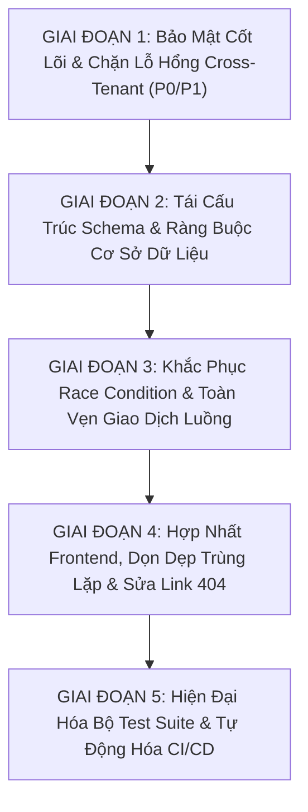

# K-Home — Kế Hoạch Cải Tiến & Lộ Trình Thực Thi (Improvement Roadmap)

> **Tài liệu:** Kế hoạch Khắc phục Toàn diện, Sắp xếp Theo Thứ tự Phụ thuộc & Mức độ Ưu tiên Nghiêm ngặt  
> **Nguyên tắc cốt lõi:**  
> 1. Bảo mật, Chống mất mát dữ liệu & Phân lập Multi-Tenant đi đầu.  
> 2. Toàn vẹn cơ sở dữ liệu & Ràng buộc quan hệ đi thứ hai.  
> 3. Kiểm soát phân quyền & Xử lý bất đồng bộ/Race Condition đi thứ ba.  
> 4. Tối ưu trải nghiệm giao diện & Dọn dẹp mã nguồn thừa đi tiếp theo.  
> 5. Tuyệt đối không thực hiện thay đổi phá hủy (breaking destructive changes) trên Production mà không có phương án kiểm thử và Rollback an toàn.  

---

## 1. Sơ Đồ Phụ Thuộc 5 Giai Đoạn (Phased Dependency Graph)

---

## 2. Chi Tiết Kế Hoạch Từng Giai Đoạn

---

### GIAI ĐOẠN 1: Bảo Mật Cốt Lõi, Khóa Secret & Chặn Lỗ Hổng Cross-Tenant

- **Mục tiêu:** Loại bỏ hoàn toàn nguy cơ giả mạo JWT `PLATFORM_ADMIN`, bịt lỗ hổng IDOR xuyên tổ hợp khi tạo hóa đơn và ngăn chặn truy cập trái phép vào các khối tháp/tầng lầu.
- **Danh sách Issue ID:**
  - `SEC-001` (P0): Loại bỏ Hard-coded Fallback Secret cho JWT token.
  - `SEC-002` (P0): Thêm kiểm tra Tenant Scope cho `TENANT_ADMIN` tại `POST /api/invoices`.
  - `SEC-003` (P1): Thêm kiểm tra Building/Tenant Scope tại `POST /api/blocks` và `POST /api/floors`.
  - `SEC-004` (P1): Sửa hàm `authorizeApartmentAccess`, chặn mặc định mở cửa khi căn hộ thiếu `buildingId`.
- **Các file & module dự kiến bị ảnh hưởng:**
  - `src/lib/auth.ts`
  - `src/middleware.ts`
  - `src/lib/authorization.ts`
  - `src/app/api/invoices/route.ts`
  - `src/app/api/blocks/route.ts`
  - `src/app/api/floors/route.ts`
- **Phụ thuộc:** Không có (Có thể thực hiện ngay lập tức mà không cần đổi schema database).
- **Rủi ro:** Nếu môi trường dev chưa set `NEXTAUTH_SECRET`, ứng dụng sẽ throw error ngay khi khởi động.
- **Test bắt buộc:**
  - Viết unit test xác nhận ứng dụng crash/báo lỗi khi `process.env.NEXTAUTH_SECRET` rỗng.
  - Test giả lập `TENANT_ADMIN` của Tenant 1 cố tình gửi request tạo hóa đơn cho căn hộ của Tenant 2: Phải nhận mã phản hồi `403 Forbidden`.
  - Test tạo khối tháp/tầng lầu cho tòa nhà ngoài thẩm quyền quản lý: Phải trả về `403 Forbidden`.
- **Definition of Done (DoD):**
  - Không còn chuỗi secret mặc định trong toàn bộ codebase.
  - Toàn bộ các API ghi nhận dữ liệu căn hộ, hóa đơn, khối nhà đều kiểm tra chặt chẽ `authorizeBuildingAccess` và `authorizeTenantAccess`.
- **Chiến lược Rollback:** Khôi phục lại các file logic authorization thông qua git commit.

---

### GIAI ĐOẠN 2: Tái Cấu Trúc Schema & Ràng Buộc Cơ Sở Dữ Liệu

- **Mục tiêu:** Chuẩn hóa mô hình quan hệ bất động sản cho môi trường Multi-Tenant thực tế; chuyển đổi mã căn hộ thành duy nhất theo tòa nhà; loại bỏ căn hộ mồ côi; bổ sung scope tổ hợp cho biểu phí và khảo sát; dọn dẹp model IoT cũ.
- **Danh sách Issue ID:**
  - `DB-001` (P1): Bỏ `@unique` toàn cục trên `Apartment.code`, thay bằng `@@unique([buildingId, code])`.
  - `DB-002` (P1): Đặt `Apartment.buildingId` thành `NOT NULL` sau khi chạy script backfill.
  - `DB-003` (P1): Bổ sung `tenantId` vào `FeeCategory` và đổi unique code thành `@@unique([tenantId, code])`.
  - `DB-004` (P1): Bổ sung `tenantId` và `buildingId` vào model `Poll`.
  - `DB-005` (P2): Dọn dẹp model `IoTSensor` và các enum liên quan khỏi `schema.prisma`.
  - `DB-006` (P2): Bổ sung trường `tenantId String?` vào model `AuditLog`.
- **Các file & module dự kiến bị ảnh hưởng:**
  - `prisma/schema.prisma`
  - Tạo mới file migration trong `prisma/migrations/`
  - `src/modules/apartment/apartment.schema.ts`
  - `src/modules/fee/fee.service.ts`, `src/modules/fee/fee.repository.ts`
  - `src/modules/poll/poll.service.ts`, `src/modules/poll/poll.repository.ts`
  - `src/modules/audit/audit-log.service.ts`
- **Phụ thuộc:** Hoàn thành Giai đoạn 1.
- **Rủi ro:** Thay đổi unique constraint trên bảng `apartments` có thể làm hỏng migration nếu database hiện tại đang có bản ghi có `buildingId = null`.
- **Biện pháp phòng ngừa:**
  1. Viết script SQL backfill kiểm tra và gán toàn bộ `buildingId` hợp lệ trước khi áp dụng `ALTER TABLE ... ALTER COLUMN buildingId SET NOT NULL`.
  2. Không chạy `prisma migrate reset` trên bất kỳ môi trường có dữ liệu thật nào.
- **Test bắt buộc:**
  - Chạy `npx prisma validate` và `npx tsc --noEmit`.
  - Kiểm tra tạo 2 căn hộ có cùng mã `A-101` ở 2 tòa nhà khác nhau: Phải thành công mỹ mãn.
  - Kiểm tra cấu hình hai biểu phí gửi xe ô tô khác giá nhau ở 2 Tenant khác nhau: Hoạt động độc lập, không ghi đè.
- **Definition of Done (DoD):**
  - Schema không còn model `IoTSensor`.
  - Migration được tạo và áp dụng sạch sẽ, không có cảnh báo mất dữ liệu.
- **Chiến lược Rollback:** Tạo file migration hoàn nguyên các lệnh `ALTER TABLE` nếu xảy ra lỗi.

---

### GIAI ĐOẠN 3: Khắc Phục Race Condition & Toàn Vẹn Giao Dịch Luồng Nghiệp Vụ

- **Mục tiêu:** Loại bỏ triệt để xung đột đồng thời trong sinh mã phiếu bãi xe, mã đặt tiện ích; bọc giao dịch thanh toán trong atomic transaction; kiểm soát phạm vi tòa nhà khi đặt tiện ích và phát thông báo khảo sát.
- **Danh sách Issue ID:**
  - `FLOW-001` (P1): Thay thế công thức `count() + 1` bằng mã ngẫu nhiên bảo mật cao trong duyệt chỗ đỗ xe.
  - `FLOW-002` (P1): Thay thế công thức `count() + 1` trong sinh mã đặt chỗ tiện ích (`bookingCode`).
  - `FLOW-003` (P1): Cập nhật query `PollService` chỉ tải và bỏ phiếu trong phạm vi Tenant/Building của cư dân.
  - `FLOW-004` (P1): Bọc hàm `invoiceRepository.processPayment` trong `prisma.$transaction`.
  - `SEC-005` (P1): Gỡ bỏ cờ `isGlobal: true` khi tạo thông báo cho cuộc khảo sát mới.
  - `SEC-006` (P1): Kiểm tra Căn hộ của cư dân phải thuộc Tòa nhà quản lý tiện ích trước khi cho phép đặt chỗ.
- **Các file & module dự kiến bị ảnh hưởng:**
  - `src/modules/parking/parking.service.ts`
  - `src/modules/facility/facility.repository.ts`
  - `src/modules/poll/poll.service.ts`, `src/modules/poll/poll.repository.ts`
  - `src/modules/invoice/invoice.repository.ts`
- **Phụ thuộc:** Hoàn thành Giai đoạn 2 (để có trường `tenantId` cho `Poll`).
- **Rủi ro:** Thấp. Đây là các cải tiến logic tầng application service và repository.
- **Test bắt buộc:**
  - Viết test mô phỏng gửi đồng thời 10 request đặt chỗ tiện ích trong cùng 1 milli-giây: Không được có request nào bị crash do trùng mã `@unique`.
  - Kiểm tra cư dân Tòa B cố tình đặt tiện ích của Tòa A: Nhận lỗi từ chối hợp lệ.
  - Kiểm tra gạch nợ thanh toán hóa đơn: Hóa đơn đổi sang `PAID` và bản ghi `PaymentTransaction` luôn cùng được commit hoặc cùng rollback.
- **Definition of Done (DoD):**
  - Không còn bất kỳ mã định danh nghiệp vụ nào phụ thuộc vào `count() + 1`.
  - 100% các thao tác thay đổi trạng thái tài chính đều được bảo vệ trong atomic transaction.

---

### GIAI ĐOẠN 4: Hợp Nhất Frontend, Dọn Dẹp Trùng Lặp & Sửa Lỗi Giao Diện

- **Mục tiêu:** Xóa bỏ sự trùng lặp 100% giữa Bản tin và Thông báo; loại bỏ các liên kết chết dẫn đến 404; đồng bộ hóa Sidebar Navigation theo vai trò thực tế.
- **Danh sách Issue ID:**
  - `FE-001` (P2): Xóa route `/announcements` và `/resident/announcements`, hợp nhất toàn bộ tính năng vào `/notifications`.
  - `FE-002` (P2): Sửa thuộc tính `actionUrl` mặc định trong `smart-alert.service.ts` trỏ đúng về trang hóa đơn/vé sự cố thay vì `/smart-operations/alerts`.
  - `FE-003` (P3): Xóa alias `/maintenance-schedules`, chuẩn hóa toàn bộ routing về `/maintenance-schedule` (hoặc ngược lại).
  - Cập nhật Sidebar Navigation: Gộp Bản tin & Thông báo thành một mục duy nhất.
- **Các file & module dự kiến bị ảnh hưởng:**
  - `src/app/(management)/announcements/` (Xóa)
  - `src/app/(resident)/resident/announcements/` (Xóa)
  - `src/app/(management)/maintenance-schedules/` (Dọn dẹp)
  - `src/components/layout/Sidebar.tsx`
  - `src/modules/smart-operations/smart-alert.service.ts`
- **Phụ thuộc:** Hoàn thành Giai đoạn 1 và 3.
- **Rủi ro:** Cần đảm bảo các bookmark hoặc link cũ điều hướng mượt mà (sử dụng Next.js redirect trong `next.config.ts` nếu cần).
- **Test bắt buộc:**
  - Kiểm tra mọi nút trên Sidebar ở tất cả 7 vai trò người dùng (Platform Admin, Tenant Admin, Manager, Tech, Security, Receptionist, Resident): Không có nút nào dẫn tới màn hình 404 hoặc bị đơ không phản hồi.
- **Definition of Done (DoD):**
  - Không còn hai trang thông báo song song gây nhầm lẫn cho người dùng.
  - Không còn liên kết chết 404 trong toàn bộ ứng dụng.

---

### GIAI ĐOẠN 5: Hiện Đại Hóa Bộ Test Suite, Đồng Bộ Seed & Tự Động Hóa CI/CD

- **Mục tiêu:** Đồng bộ hóa dữ liệu Multi-Tenant vào script seed chính; cô lập môi trường chạy test để tránh nguy cơ ô nhiễm database Neon; cập nhật các mock data bị lỗi thời; dọn dẹp cảnh báo ESLint.
- **Danh sách Issue ID:**
  - `TEST-001` (P1): Tách biệt môi trường test DB, ngăn chặn integration test ghi đè dữ liệu Neon hiện tại.
  - `TEST-002` (P2): Sửa lỗi mock trong `tests/backend-security.test.ts` để 100% test pass.
  - `TEST-003` (P3): Khắc phục các lỗi ESLint (`no-explicit-any`), cấu hình rule hợp lý cho thư mục `tests/`.
  - Đồng bộ `scripts/backfill-multi-tenant.ts` vào `prisma/seed.ts` để lệnh `npm run db:seed` tạo sẵn hệ sinh thái Multi-Tenant hoàn chỉnh.
- **Các file & module dự kiến bị ảnh hưởng:**
  - `prisma/seed.ts`
  - `tests/backend-security.test.ts`
  - `eslint.config.mjs`
  - `package.json`
- **Phụ thuộc:** Hoàn thành Giai đoạn 1, 2, 3, 4.
- **Test bắt buộc:**
  - Chạy `npm run lint`: Phải thoát với mã 0 (không còn lỗi chặn).
  - Chạy `npx tsx --test tests/backend-security.test.ts`: Phải pass 16/16 test cases.
  - Chạy thử `prisma db seed` trên môi trường local Docker: Tạo đầy đủ 2 Tenant, 2 Building, phân công Manager và các căn hộ mẫu.
- **Definition of Done (DoD):**
  - Tất cả các lệnh `npm run lint`, `npx tsc --noEmit`, và các bộ test suite đều xanh (Pass 100%).
  - Dự án K-Home chính thức đạt trạng thái Production-Ready.
