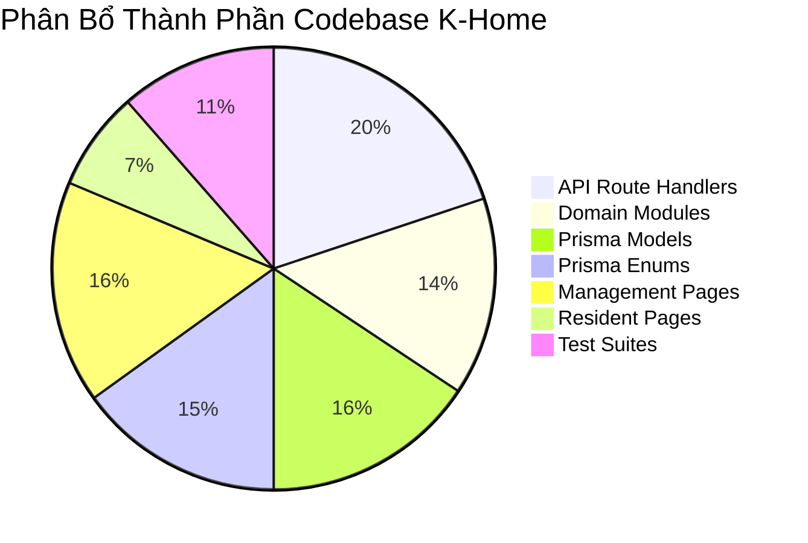

# K-Home — Báo Cáo Sức Khỏe Toàn Diện Dự Án (Project Health Report)

> **Dự án:** K-Home — Smart Living, Better Together  
> **Hệ thống:** Nền tảng Quản trị & Vận hành Chung cư Thông minh Chuẩn Quốc tế  
> **Vai trò đánh giá:** Principal Software Architect, Senior Full-Stack Engineer, Database Architect, Security Engineer, QA Engineer  
> **Thời điểm kiểm toán:** Tháng 10/2026  
> **Phương pháp kiểm toán:** Read-Only Static Code Analysis, Schema & Migration Audit, Route Flow Tracing, Unit & Type-check Verification  

---

## 1. Tóm Tắt Điều Hành (Executive Summary)

Dự án **K-Home** là một hệ thống quản lý vận hành chung cư quy mô doanh nghiệp (Enterprise SaaS), được xây dựng trên nền tảng **Next.js App Router (v16.3.1)**, **React 19**, **Prisma ORM 5.22.0**, **PostgreSQL (Neon)** và hệ sinh thái thư viện hiện đại (**Tailwind CSS v4, shadcn/ui, TanStack Query v5, Zod v4, NextAuth.js v4**).

Hệ thống đã trải qua các đợt phát triển liên tục, bao gồm việc tái cấu trúc mô hình cư trú (tách chủ hộ/người thuê/cư dân thành `ApartmentOwnership` và `ApartmentResident`), thiết kế hệ thống bãi xe thông minh phân tầng (`ParkingArea` → `ParkingZone` → `ParkingSlot` → `ParkingAssignment`), tích hợp tính cước phương tiện tự động vào hóa đơn hàng tháng, và bổ sung lớp nền Multi-Tenant (`Tenant`, `PLATFORM_ADMIN`, `TENANT_ADMIN`).

### Điểm Sức Khỏe Tổng Thể: **74 / 100 (B+)**

| Trụ cột đánh giá | Điểm số | Trạng thái | Tóm tắt nhận định |
|---|:---:|:---:|---|
| **Kiến trúc Code & Type Safety** | **88/100** | 🟢 Tốt | 100% Type-checked sạch sẽ (`tsc --noEmit` pass 0 errors). Áp dụng chặt chẽ kiến trúc 5 lớp (UI → Hook → Client Service → API Route Handler → Module Service → Repository/Prisma). |
| **Mô hình Dữ liệu (Database)** | **70/100** | 🟡 Cần chú ý | Lược đồ phong phú, chuẩn hóa tốt các quan hệ sở hữu/cư trú và bãi xe. Tuy nhiên, vẫn còn ràng buộc `@unique` toàn cục trên mã căn hộ (`Apartment.code`), `FeeCategory` chia sẻ toàn cục không theo Tenant, và mô hình IoT (`IoTSensor`) còn tồn dư trong schema. |
| **Bảo mật & Phân quyền (RBAC/Tenant)** | **65/100** | 🔴 Nghiêm trọng | Đã thiết kế RBAC chi tiết và phòng chống IDOR cư dân tốt. Nhưng tồn tại lỗ hổng P0 về **Hard-coded Fallback Secret trong JWT authentication**, thiếu kiểm tra Tenant Scope cho `TENANT_ADMIN` ở một số endpoint (Invoices, Facilities, Polls, Blocks), và rò rỉ dữ liệu thông báo toàn cục (`isGlobal: true`). |
| **Luồng Nghiệp vụ (Workflows)** | **75/100** | 🟡 Trung bình khá | Các luồng FSM vé bảo trì, tính phí gửi xe theo phương tiện thực tế, và gạch nợ hóa đơn hoạt động rất tốt. Tuy nhiên, xuất hiện **Race Condition** trong sinh mã tự động bằng `count() + 1` (đặt chỗ tiện ích, đăng ký đỗ xe) và thao tác thanh toán hóa đơn chưa được bọc hoàn toàn trong atomic transaction. |
| **Giao diện & UI/UX** | **78/100** | 🟢 Khá | Giao diện chuẩn thương hiệu K-Home (`#0F6B4F`), component shadcn/ui trau chuốt, hỗ trợ Breadcrumb, Topbar, Sidebar theo Role. Tuy nhiên, có **sự trùng lặp 100% giữa 2 module** (`/announcements` và `/notifications`), và một số route 404 (như link cảnh báo `/smart-operations/alerts`). |
| **Kiểm thử & QA** | **68/100** | 🟡 Cần cải thiện | Có 19 file test bao quát logic. Các unit test thuần (ticket workflow, rbac permissions, resident auth mock) chạy cực nhanh và pass 100%. Tuy nhiên, nhiều integration test đang ghi trực tiếp vào DB, `tests/backend-security.test.ts` bị fail do mock dữ liệu schema cũ, và ESLint bị lỗi với hơn 1.500 cảnh báo/lỗi format. |

---

## 2. Xác Minh Công Nghệ Thực Tế So Với Mục Tiêu

| Công nghệ | Phiên bản thực tế | Trạng thái xác minh | Ghi chú kiến trúc |
|---|---|:---:|---|
| **Next.js** | `16.3.1` (App Router) | ✅ Khớp | Sử dụng Route Handlers tại `src/app/api/**/route.ts`, chia route groups `(auth)`, `(management)`, `(resident)`. |
| **React** | `19.2.8` | ✅ Khớp | React 19 mới nhất, kết hợp React DOM `19.2.8`. |
| **TypeScript** | `^5` | ✅ Khớp | `tsconfig.json` cấu hình strict mode, chạy pass 100% không có lỗi type. |
| **Tailwind CSS** | `@tailwindcss/postcss ^4`, `tailwindcss ^4` | ✅ Khớp | Tailwind CSS v4 mới nhất qua PostCSS plugin `@tailwindcss/postcss`. |
| **Component UI** | Radix UI primitives, lucide-react `1.31.0` | ✅ Khớp | Tích hợp hệ thống component phong cách shadcn/ui. |
| **TanStack React Query** | `^5.101.4` | ✅ Khớp | Sử dụng custom hooks quản lý query key và cache invalidation tại `src/hooks/use-*.ts`. |
| **Zod** | `^4.4.3` | ✅ Khớp | Dùng cho form validation client-side và payload validation server-side. |
| **NextAuth.js** | `^4.24.11` | ✅ Khớp | JWT session strategy, bcryptjs hash, tích hợp rate-limiter login. |
| **Prisma ORM** | `^5.22.0` | ✅ Khớp | Quản lý PostgreSQL database schema, migrations và typed client. |
| **PostgreSQL** | Neon cloud (Production) / Postgres 15 Alpine (Docker) | ✅ Khớp | Kết nối qua `DATABASE_URL` pooling/direct string. |
| **Deployment Target** | Vercel | ✅ Khớp | Next.js serverless functions trên Vercel. |

---

## 3. Thống Kê Tổng Thể Hệ Thống



- **Database Models (Prisma):** 26 models, 25 enums, 6 migrations đã áp dụng.
- **Backend API Routes:** 33 thư mục endpoint với hơn 55 HTTP methods (GET, POST, PUT, PATCH, DELETE).
- **Domain Modules:** 24 modules độc lập tại `src/modules/` (mỗi module tuân thủ cấu trúc `*.service.ts`, `*.repository.ts`, `*.schema.ts`, `*.types.ts`).
- **Giao diện Frontend (App Router):**
  - Nhóm `(auth)`: 2 routes (`/login`, `/register`).
  - Nhóm `(management)`: 27 routes dành cho Platform Admin, Tenant Admin, Manager và Nhân viên vận hành.
  - Nhóm `(resident)`: 12 routes chuyên biệt cho cổng thông tin Cư dân.
- **Test Suites:** 19 file test trong thư mục `tests/` với hơn 180 test cases.

---

## 4. Điểm Mạnh Nổi Bật Về Mặt Kiến Trúc

1. **Tuân thủ xuất sắc mô hình kiến trúc 5 lớp (5-Tier Layered Architecture):**
   ```
   UI Components (React / Tailwind / shadcn)
     └── React Query Hooks (src/hooks/use-*.ts)
           └── Client Services (src/services/*.service.ts)
                 └── API Route Handlers (src/app/api/**/route.ts)
                       └── Module Services (src/modules/*/*.service.ts)
                             └── Repositories & Prisma ORM (PostgreSQL)
   ```
   Không có tình trạng gọi trực tiếp Prisma từ UI Components hay trộn lẫn logic query vào layout.
2. **Tách biệt rõ ràng thực thể Con người và Căn hộ (Domain Segregation):**
   - Đã xóa bỏ hoàn toàn các cột di sản sai lầm như `resident.apartmentId`.
   - `User` (tài khoản đăng nhập) tách rời khỏi `Resident` (hồ sơ nhân khẩu/CCCD).
   - `ApartmentOwnership` quản lý quan hệ sở hữu tài sản (sổ hồng, đồng sở hữu).
   - `ApartmentResident` quản lý quan hệ cư trú thực tế (chủ hộ, người phụ thuộc, khách thuê).
3. **Mô hình Bãi xe thông minh (Smart Parking Hierarchy):**
   - Phân cấp chuẩn mực: `Building` → `ParkingArea` (tầng hầm) → `ParkingZone` (khu vực xe máy/ô tô/EV) → `ParkingSlot` (vị trí đỗ có tọa độ X/Y cho Interactive Map) → `ParkingAssignment` (gắn phương tiện, cấp mã QR Token độc nhất).
   - Tích hợp tính phí trông giữ xe động vào hóa đơn hàng tháng dựa trên phương tiện thực tế đang kích hoạt.
4. **State Machine và SLA Engine vé sự cố hoàn chỉnh:**
   - Hỗ trợ FSM chuyển trạng thái nghiêm ngặt (`NEW` → `ASSIGNED` → `PROCESSING` → `RESOLVED` → `CLOSED`), ngăn chặn bước nhảy cóc.
   - Tính toán SLA theo mức độ ưu tiên (`URGENT`/`CRITICAL`: 4h, `HIGH`: 24h, `MEDIUM`: 48h, `LOW`: 72h).
5. **Hệ thống Audit Log xuyên suốt:**
   - Lưu trữ vết toàn diện (`audit_logs`) cho mọi hành động nhạy cảm: phát hành hóa đơn, thanh toán, thay đổi trạng thái bãi xe, phê duyệt hồ sơ cư trú, tạo cuộc khảo sát, thay đổi cấu hình tài sản.

---

## 5. Các Vấn Đề Kiến Trúc & Rủi Ro Cốt Lõi Cần Giải Quyết

Qua kiểm toán chi tiết, hệ thống tồn tại **5 nút thắt cốt lõi**:

1. **Rủi ro rò rỉ và giả mạo quyền qua Fallback JWT Secret (P0):**
   - File `src/lib/auth.ts` và `src/middleware.ts` có chuỗi fallback hardcoded `'smart-apartment-secret-jwt-key-2026-very-secure'`. Nếu môi trường triển khai thiếu biến môi trường `NEXTAUTH_SECRET`, bất kỳ ai cũng có thể giả mạo token `PLATFORM_ADMIN`.
2. **Sự không đồng nhất trong Multi-Tenant Data Scoping (P0 / P1):**
   - Schema đã có `Tenant`, nhưng các thực thể như `Apartment` có trường `buildingId` là `nullable`. Nếu căn hộ không gắn `buildingId`, cơ chế phân quyền mặc định mở cửa cho mọi Manager/Admin (`allowed: true`).
   - Các thực thể `FeeCategory` và `Poll` hoàn toàn không có `tenantId` hoặc `buildingId`. Các tổ hợp khác nhau bị ép dùng chung biểu giá và cư dân tổ hợp A nhìn thấy khảo sát của tổ hợp B.
   - Endpoint `POST /api/invoices` chỉ kiểm tra tòa nhà khi `role === 'MANAGER'`, bỏ quên `TENANT_ADMIN`, dẫn đến nguy cơ IDOR xuyên tổ hợp (Cross-Tenant Invoicing).
3. **Ràng buộc duy nhất toàn cục sai logic trên Căn hộ (`Apartment.code @unique`) (P1):**
   - Mã căn hộ như `A-101` hiện đang là `@unique` trên toàn bộ bảng `apartments`. Khi triển khai nhiều tòa nhà hoặc nhiều Tenant, hai tòa nhà khác nhau không thể cùng có căn hộ số `101`.
4. **Race Condition trong sinh mã định danh và đặt chỗ (P1 / P2):**
   - Mã đặt chỗ (`bookingCode`), mã đăng ký gửi xe (`requestCode`), và mã phân công chỗ đỗ (`assignmentCode`) đều được sinh theo công thức `count() + 1` ngoài transaction lock. Khi có hai thao tác đồng thời, giao dịch thứ hai chắc chắn sập do trùng mã `@unique`.
5. **Thất thoát tính nguyên tử trong xử lý thanh toán (P1):**
   - Phương thức `invoiceRepository.processPayment` cập nhật trạng thái hóa đơn sang `PAID` và tạo bản ghi `paymentTransaction` trong hai câu lệnh riêng biệt không bọc trong `prisma.$transaction`. Nếu tạo bản ghi giao dịch thất bại, hóa đơn vẫn bị gạch nợ sai lệch sổ sách tài chính.

---

## 6. Ma Trận Đánh Giá Theo Module Chức Năng

| Module | Trạng thái kỹ thuật | Mức độ hoàn thiện | Đánh giá chính |
|---|:---:|:---:|---|
| **Auth & Multi-Tenant Core** | Hoạt động (Có rủi ro P0) | **80%** | Xác thực JWT hoạt động tốt, rate-limiting đầy đủ. Cần gỡ secret fallback và hoàn thiện liên kết Tenant trong seed. |
| **Tòa nhà, Khối, Tầng, Căn hộ** | Hoạt động | **85%** | Phân cấp `Building` → `Block` → `Floor` → `Apartment` hoàn chỉnh. Cần sửa `Apartment.code` unique theo building, bắt buộc `buildingId`. |
| **Cư dân, Chủ sở hữu & Hợp đồng** | Hoạt động | **90%** | Tách bạch `ApartmentOwnership` & `ApartmentResident`. Cần cập nhật mock test schema cũ và hoàn thiện UI quản lý đồng sở hữu. |
| **Hóa đơn & Thanh toán** | Hoạt động (Có rủi ro P1) | **85%** | Tự động hóa tính cước m2 và số xe động. Cần bọc transaction nguyên tử cho thanh toán và kiểm tra Tenant scope khi tạo hóa đơn. |
| **Bãi đỗ xe thông minh** | Hoạt động | **90%** | Sơ đồ bãi xe, chia khu vực, thẻ xe, nhật ký ra vào rất tốt. Cần loại bỏ race condition sinh mã `count() + 1`. |
| **Tiện ích & Đặt chỗ** | Hoạt động | **80%** | Khóa chống overbooking thời gian thực tốt. Cần bổ sung kiểm tra quyền cư trú tại tòa nhà của tiện ích và sinh mã an toàn. |
| **Khảo sát ý kiến cư dân** | Hoạt động một phần | **65%** | Ràng buộc 1 phiếu/căn hộ rất tốt. Tuy nhiên thiếu `buildingId`/`tenantId` khiến khảo sát bị phát sóng toàn cầu (`isGlobal`). |
| **Khách thăm & Ra vào** | Hoạt động | **85%** | Cấp mã QR, bảo vệ quét QR check-in/check-out đầy đủ. |
| **Quản lý Bưu kiện** | Hoạt động | **85%** | Quy trình tiếp nhận, mã nhận bưu kiện, ký nhận rõ ràng. |
| **Bảo trì, Tài sản & Sự cố** | Hoạt động | **92%** | Module hoàn thiện nhất hệ thống: FSM, SLA, phân công kỹ thuật viên, lịch bảo trì định kỳ, liên kết tài sản. |
| **Thông báo & Bản tin** | Trùng lặp UI | **70%** | Tồn tại 2 trang trùng lặp (`/announcements` và `/notifications`). Cần hợp nhất thành một phân hệ duy nhất. |
| **Smart Operations & IoT** | **Đã loại bỏ** | **100% (Loại bỏ)** | Đã loại bỏ runtime code theo yêu cầu. Chỉ còn sót model `IoTSensor` trong Prisma schema cần xóa dọn dẹp. |

---

## 7. Kết Luận

Hệ thống **K-Home** đã sở hữu một bộ khung kiến trúc rất bài bản, chất lượng mã nguồn TypeScript cao và tư duy thiết kế domain sạch sẽ. Các vấn đề hiện tại không bắt nguồn từ việc viết code cẩu thả, mà đến từ **quá trình tiến hóa nghiệp vụ** (chuyển đổi từ chung cư đơn lẻ sang mô hình Multi-Tenant SaaS và tái cấu trúc mô hình cư dân).

Sau khi hoàn thành lộ trình khắc phục 5 giai đoạn được trình bày trong tài liệu `improvement-roadmap.md`, dự án K-Home sẽ đạt trạng thái vững chắc, an toàn tuyệt đối và sẵn sàng để triển khai thực tế trên môi trường Production.
