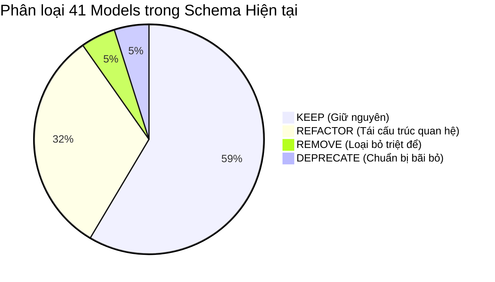

# K-HOME DATA MODEL AUDIT & COMPREHENSIVE ARCHITECTURE REPORT

> **Tài liệu:** Báo cáo Kiểm toán Mô hình Dữ liệu & Mối quan hệ Nghiệp vụ Toàn hệ thống K-Home  
> **Dự án:** K-Home — Smart Property & Enterprise Apartment Management System  
> **Phiên bản kiến trúc:** 2.0 (Post-IoT Architecture Refactoring)  
> **Tác giả:** Senior Software Architect & Senior Database Architect  
> **Ngày lập:** 12/10/2026  

---

## 1. TỔNG QUAN HIỆN TRẠNG DATABASE & CODEBASE

Hệ thống K-Home hiện tại được xây dựng trên nền tảng:
* **Database Engine:** PostgreSQL (Neon Cloud Serverless PostgreSQL).
* **ORM:** Prisma ORM 5.22.0.
* **Lịch sử Migration:** Đang ghi nhận 3 migration chính thức trong `prisma/migrations`:
  1. `0_init`: Khởi tạo nền tảng bất động sản, cư dân, hợp đồng, hóa đơn, sự cố, thông báo.
  2. `20260911000000_add_vehicle_and_parking_management`: Bổ sung phân hệ phương tiện & bãi đỗ xe thông minh.
  3. `20261004172500_sync_smart_apartment_schema`: Mở rộng tài sản, lịch bảo trì, nhân sự, tiện ích, bưu kiện, khách thăm và khảo sát.

### Thống kê quy mô mô hình dữ liệu hiện tại
* **Tổng số Models:** 41 models.
* **Tổng số Enums:** 24 enums.
* **Tổng số Bảng quan hệ (Join Tables):** 5 bảng (`ManagerBuilding`, `NotificationApartment`, `NotificationRead`, `PollVote`, `InvoiceItem`).

---

## 2. BẢNG KIỂM TOÁN TỔNG HỢP CÁC MODELS HIỆN TẠI (INVENTORY & CLASSIFICATION)

Dưới đây là bảng đánh giá toàn bộ 41 models trong schema hiện tại theo 6 trạng thái nghiệp vụ chuẩn:
* **KEEP:** Giữ nguyên mô hình vì thiết kế chuẩn và đang vận hành ổn định.
* **REFACTOR:** Giữ thực thể nhưng chuẩn hóa lại quan hệ, foreign keys hoặc bổ sung ràng buộc.
* **MERGE:** Hợp nhất với thực thể khác do trùng lặp hoặc phân mảnh trách nhiệm.
* **DEPRECATE:** Đánh dấu ngưng sử dụng, chuẩn bị loại bỏ theo lộ trình.
* **REMOVE:** Thực thể dư thừa hoặc thuộc module đã bị bãi bỏ (như IoT).
* **INVESTIGATE:** Cần theo dõi thêm do dữ liệu giao thoa giữa các module.

| STT | Tên Model | Nhóm nghiệp vụ | Mục đích hiện tại | Trạng thái đề xuất | Đánh giá & Rủi ro phát hiện |
| :---: | :--- | :--- | :--- | :---: | :--- |
| 1 | `User` | Xác thực & Phân quyền | Tài khoản đăng nhập, JWT session, RBAC | **REFACTOR** | Thiếu liên kết đa chiều tới Owner; chỉ có 1-1 với Resident. |
| 2 | `Building` | Bất động sản | Tòa nhà gốc | **KEEP** | Khá chuẩn, cần kiểm tra scoping quan hệ xuống Apartment. |
| 3 | `ManagerBuilding` | Phân quyền vận hành | Phân công Manager quản lý Building | **REFACTOR** | Thiếu thời hạn phân công (`startDate`, `endDate`), lịch sử phân công. |
| 4 | `Block` | Bất động sản | Khối nhà / Tháp (Tower) trong Tòa nhà | **KEEP** | Có unique `[buildingId, code]` chuẩn. |
| 5 | `Floor` | Bất động sản | Tầng trong Khối nhà | **KEEP** | Có unique `[blockId, floorNumber]` chuẩn. |
| 6 | `Apartment` | Bất động sản | Căn hộ | **REFACTOR** | Chứa trường legacy `building String`, `floor Int` mâu thuẫn với FKs; mã căn hộ unique toàn cục thay vì scoped. |
| 7 | `ApartmentHistory` | Lịch sử căn hộ | Nhật ký thay đổi trạng thái, cư dân, chủ nhà | **KEEP** | Phản ánh tốt Audit trail cho căn hộ. |
| 8 | `Resident` | Cư dân | Hồ sơ nhân khẩu, CCCD, thông tin liên lạc | **REFACTOR** | Bị khóa cứng vào 1 căn hộ (`apartmentId?`); không hỗ trợ chủ sở hữu nhiều căn hoặc chủ nhà không ở. |
| 9 | `Contract` | Hợp đồng | Hợp đồng mua bán / thuê căn hộ | **REFACTOR** | Gộp cả SALE và RENT vào 1 model nhưng thiếu bên thứ 2 (bên bán/cho thuê). |
| 10 | `FeeCategory` | Tài chính | Danh mục biểu phí định mức hệ thống | **KEEP** | Thiết kế tốt, có `isSystem` bảo vệ. |
| 11 | `Invoice` | Tài chính | Hóa đơn tiền nhà, phí dịch vụ | **REFACTOR** | Chỉ liên kết `apartmentId`, thiếu `residentId` (người chịu trách nhiệm thanh toán); thiếu bảng Payment con. |
| 12 | `InvoiceItem` | Tài chính | Chi tiết dòng mục phí trong hóa đơn | **KEEP** | Hoạt động chính xác và liên kết tốt với `FeeCategory`. |
| 13 | `Feedback` | Kỹ thuật & Sự cố | Phiếu phản ánh / sự cố từ cư dân | **REFACTOR** | Thiếu liên kết trực tiếp tới `WorkOrder` khi cần điều phối vật tư. |
| 14 | `TicketStatusHistory` | Kỹ thuật & Sự cố | Lịch sử chuyển trạng thái SLA ticket | **KEEP** | Rất chuẩn cho kiểm toán tiến độ SLA. |
| 15 | `TicketComment` | Kỹ thuật & Sự cố | Bình luận trao đổi trên ticket | **KEEP** | Có cờ `isInternal` phân biệt nội bộ/cư dân. |
| 16 | `Notification` | Truyền thông | Thông báo chung và đích danh | **KEEP** | Hỗ trợ phân quyền và phạm vi tốt. |
| 17 | `NotificationApartment` | Truyền thông | Bảng liên kết thông báo gửi theo căn hộ | **KEEP** | Cần thiết cho gửi thông báo chọn lọc. |
| 18 | `NotificationRead` | Truyền thông | Trạng thái đọc thông báo của User | **KEEP** | Có unique `[notificationId, userId]`. |
| 19 | `AuditLog` | Kiểm toán | Nhật ký thao tác hệ thống toàn cục | **KEEP** | Lưu vết thay đổi quyền, hóa đơn, căn hộ. |
| 20 | `Vehicle` | Phương tiện | Phương tiện cư dân đăng ký | **REFACTOR** | Chứa cả `apartmentId` và `residentId`; quan hệ xe với chủ sở hữu chưa độc lập. |
| 21 | `ParkingCard` | Bãi đỗ xe | Thẻ gửi xe từ / RFID | **REFACTOR** | Khóa cứng thẻ vào 1 `Vehicle` duy nhất thay vì có thể cấp phát/thu hồi linh hoạt. |
| 22 | `ParkingArea` | Bãi đỗ xe | Bãi đỗ xe (Hầm B1, Hầm B2, Ngoài trời) | **KEEP** | Liên kết trực tiếp `Building`. |
| 23 | `ParkingZone` | Bãi đỗ xe | Khu vực phân loại theo loại xe (Zone A, B) | **KEEP** | Liên kết `ParkingArea`. |
| 24 | `ParkingSlot` | Bãi đỗ xe | Vị trí ô đỗ cụ thể trên sơ đồ | **REFACTOR** | Lưu cả `areaId` và `zoneId` gây dư thừa và nguy cơ mâu thuẫn dữ liệu cha-con. |
| 25 | `ParkingRegistrationRequest` | Bãi đỗ xe | Đơn đăng ký gửi xe của cư dân | **KEEP** | Quy trình phê duyệt đầy đủ từ PENDING -> APPROVED. |
| 26 | `ParkingAssignment` | Bãi đỗ xe | Phân công chỗ đỗ đang có hiệu lực | **REFACTOR** | Thiếu ràng buộc chống trùng lặp gán cùng 1 slot đang ACTIVE; QR token cần quản lý vòng đời. |
| 27 | `ParkingAccessLog` | Bãi đỗ xe | Lịch sử quẹt thẻ xe ra/vào cổng | **KEEP** | Lưu vết thực tế với ảnh chụp biển số. |
| 28 | `ResidenceRequest` | Cư dân | Yêu cầu tạm trú, tạm vắng, thêm nhân khẩu | **KEEP** | Quy trình duyệt nhân khẩu hoàn chỉnh. |
| 29 | `StaffProfile` | Nhân sự | Hồ sơ nhân viên kỹ thuật, an ninh, lễ tân | **KEEP** | Quản lý ca trực (`currentShift`) và khu vực phân công. |
| 30 | `Asset` | Tài sản tòa nhà | Thiết bị tòa nhà (Thang máy, máy bơm, PCCC) | **KEEP** | Quản lý hạn bảo hành và nhà cung cấp. |
| 31 | `MaintenanceSchedule` | Kỹ thuật & Bảo trì | Lịch bảo dưỡng thiết bị định kỳ | **KEEP** | Chu kỳ rõ ràng (`DAILY`, `MONTHLY`, `QUARTERLY`). |
| 32 | `WorkOrder` | Kỹ thuật & Bảo trì | Phiếu giao việc sửa chữa thiết bị | **REFACTOR** | Cần bổ sung optional foreign key liên kết tới `Feedback` để đóng vòng lặp sự cố. |
| 33 | `Facility` | Tiện ích | Tiện ích công cộng (Hồ bơi, Gym, BBQ) | **KEEP** | Quản lý khung giờ và phí dịch vụ. |
| 34 | `FacilityBooking` | Tiện ích | Lịch đặt tiện ích của cư dân | **KEEP** | Kiểm soát xung đột khung giờ (`startTimeDate`, `endTimeDate`). |
| 35 | `VisitorPass` | An ninh & Khách | Thẻ khách thăm có mã QR ra vào | **KEEP** | Check-in, check-out và liên kết người bảo lãnh. |
| 36 | `ParcelDelivery` | Lễ tân & Bưu kiện | Giao nhận bưu kiện | **KEEP** | Mã OTP/pickupCode và nhật ký bàn giao. |
| 37 | `Poll` | Biểu quyết | Khảo sát / Biểu quyết ý kiến cư dân | **KEEP** | Phân loại phạm vi (`targetScope`). |
| 38 | `PollOption` | Biểu quyết | Phương án biểu quyết | **KEEP** | Liên kết `Poll`. |
| 39 | `PollVote` | Biểu quyết | Phiếu biểu quyết của từng căn hộ | **KEEP** | Unique constraint `[pollId, apartmentId]` đảm bảo mỗi căn hộ chỉ bỏ 1 phiếu. |
| 40 | `IoTSensor` | Vận hành IoT | Cảm biến phần cứng giả lập | **REMOVE** | Module IoT đã bị loại bỏ hoàn toàn; bảng không còn runtime code sử dụng. |
| 41 | `SmartAlertRecord` | Vận hành thông minh | Cảnh báo vi phạm SLA, công nợ, bảo trì | **REFACTOR** | Cần gỡ bỏ quan hệ tới `IoTSensor` (`sensorId`) để trở thành mô hình Operational Alert thuần túy. |

---

## 3. PHÂN LOẠI CHI TIẾT 14 NHÓM VẤN ĐỀ NGHIỆP VỤ & HẬU QUẢ THỰC TẾ

### Vấn đề 1: Dữ liệu Denormalized thiếu đồng bộ trong Cấu trúc Bất động sản
* **Vị trí:** Model `Apartment` chứa cả trường chuỗi/số legacy (`building String`, `floor Int`) song song với quan hệ phân cấp (`buildingId String?`, `blockId String?`, `floorId String?`).
* **Hậu quả:** 
  * Khi cập nhật căn hộ từ Tầng 10 sang Tầng 11, nếu API chỉ cập nhật `floorId` mà quên cập nhật `floor`, client đọc trường legacy sẽ thấy dữ liệu sai.
  * Nguy cơ tạo ra căn hộ có `blockId` thuộc Block A nhưng `floorId` lại thuộc Block B.
* **Mức độ:** **CAO (High)**.

### Vấn đề 2: Mã Căn hộ bị Unique toàn cục thay vì Scoped theo Tòa nhà
* **Vị trí:** `Apartment.code @unique`.
* **Hậu quả:** Trong khu đô thị có nhiều tòa nhà (VD: Tòa Sky và Tòa Oasis), cả 2 tòa đều có căn `1001` (Tầng 10, Căn 01). Việc đặt `@unique` toàn cục khiến hệ thống không thể tạo mã căn hộ trùng lặp tự nhiên theo tòa nhà, buộc người dùng phải đặt tiền tố giả tạo như `SKY-1001`, `OASIS-1001`.
* **Mức độ:** **TRUNG BÌNH (Medium)**.

### Vấn đề 3: Khóa cứng quan hệ Cư dân - Căn hộ (1 Resident chỉ thuộc 1 Apartment)
* **Vị trí:** `Resident.apartmentId String?`.
* **Hậu quả:** 
  * **Trường hợp Chủ sở hữu nhiều căn hộ:** Một khách hàng mua 3 căn hộ trong cùng khu chung cư (để ở 1 căn, cho thuê 2 căn). Với schema hiện tại, `Resident` chỉ có 1 `apartmentId`, không thể gán ông A làm chủ của cả 3 căn hộ. Nếu tạo 3 hồ sơ `Resident` riêng thì sẽ bị lỗi vi phạm ràng buộc `identityCard @unique` (CCCD duy nhất).
  * **Trường hợp Chủ hộ không sinh sống tại căn hộ (Absent Owner):** Khi căn hộ được cho thuê lại cho một người khác (Tenant), nếu đổi `Resident.apartmentId` sang người thuê, toàn bộ thông tin liên kết của chủ sở hữu căn hộ bị xóa sạch khỏi căn hộ đó.
* **Mức độ:** **NGHIÊM TRỌNG (Critical)**.

### Vấn đề 4: Thiếu thực thể Quan hệ Sở hữu Căn hộ độc lập (`PropertyOwnership`)
* **Vị trí:** Schema hiện tại không có bảng `ApartmentOwner` hay `PropertyOwnership`.
* **Hậu quả:** Mối quan hệ sở hữu tài sản chỉ được thể hiện qua enum `Resident.relationshipToOwner = OWNER`. Không thể ghi nhận:
  * Tỷ lệ sở hữu (VD: Vợ chồng đồng sở hữu 50% - 50%).
  * Thời hạn bắt đầu và kết thúc quyền sở hữu (lịch sử chuyển nhượng bất động sản).
  * Giấy chứng nhận quyền sở hữu (Sổ hồng / Hợp đồng mua bán gốc).
* **Mức độ:** **NGHIÊM TRỌNG (Critical)**.

### Vấn đề 5: Hợp đồng gộp cả Mua bán (SALE) và Thuê (RENT) nhưng thiếu Bên đối tác
* **Vị trí:** Model `Contract` chỉ có `residentId` và `apartmentId`.
* **Hậu quả:** 
  * Hợp đồng thuê thực tế có 2 bên: Bên cho thuê (Chủ nhà hoặc Ban Quản lý) và Bên thuê (Tenant). Hiện tại `Contract` chỉ trỏ tới 1 `residentId`.
  * Hợp đồng mua bán (SALE) có Chủ đầu tư / Người bán và Người mua. Model hiện tại không lưu được thông tin bên bán.
* **Mức độ:** **TRUNG BÌNH (Medium)**.

### Vấn đề 6: Dư thừa quan hệ phân cấp trong Chỗ đỗ xe (`ParkingSlot`)
* **Vị trí:** Model `ParkingSlot` chứa cả `areaId String` và `zoneId String`. Trong khi đó `ParkingZone` đã chứa `areaId String` (`ParkingZone.areaId -> ParkingArea.id`).
* **Hậu quả:** Trùng lặp khóa ngoại. Tiềm ẩn lỗi không nhất quán: `ParkingSlot` có `areaId = Area_1` nhưng `zoneId` lại thuộc `Area_2`.
* **Mức độ:** **TRUNG BÌNH (Medium)**.

### Vấn đề 7: Thiếu ràng buộc chống Phân công Chỗ đỗ xe trùng lặp (Double Booking)
* **Vị trí:** Model `ParkingAssignment` chỉ có `@@index([slotId])` và `@@index([status])`, không có ràng buộc unique ở mức database cho các slot đang có hiệu lực (`ACTIVE`).
* **Hậu quả:** Nếu có 2 yêu cầu được duyệt đồng thời (Race Condition), một ô đỗ xe có thể bị gán cho 2 chiếc xe khác nhau trong cùng một khoảng thời gian.
* **Mức độ:** **CAO (High)**.

### Vấn đề 8: Khóa cứng Thẻ gửi xe (`ParkingCard`) vào Phương tiện
* **Vị trí:** `ParkingCard.vehicleId String` (Quan hệ 1-Nhiều nhưng cố định).
* **Hậu quả:** Khi thẻ xe bị mất hoặc hỏng và cần cấp lại thẻ mới, hoặc khi cư dân đổi xe mới nhưng giữ nguyên thẻ gửi xe, việc đổi quan hệ trong DB gặp khó khăn. Thẻ từ thực chất là vật phẩm quản trị thuộc bãi đỗ xe hoặc hợp đồng gửi xe, không phải thuộc tính vật lý của chiếc xe.
* **Mức độ:** **THẤP (Low)**.

### Vấn đề 9: Hóa đơn (`Invoice`) không có liên kết tới Người nộp tiền (`Resident`)
* **Vị trí:** `Invoice.apartmentId String`. Không có `residentId` hay `payerId`.
* **Hậu quả:** 
  * Hóa đơn chỉ gắn với căn hộ. Khi căn hộ đổi chủ hoặc đổi người thuê giữa tháng, hệ thống khó xác định chính xác ai là người chịu trách nhiệm thanh toán khoản nợ tồn đọng của kỳ trước.
  * Việc gửi thông báo nhắc nợ đích danh tới email/app của cư dân phải thông qua câu query gián tiếp tìm cư dân trong căn hộ.
* **Mức độ:** **CAO (High)**.

### Vấn đề 10: Thiếu bảng Nhật ký Giao dịch Thanh toán (`PaymentTransaction`)
* **Vị trí:** `Invoice` lưu trực tiếp `paidAt DateTime?`, `paymentMethod PaymentMethod?`, `transactionId String?`.
* **Hậu quả:** 
  * Không hỗ trợ thanh toán từng phần (VD: Hóa đơn 5.000.000đ, cư dân trả trước 2.000.000đ).
  * Không lưu được lịch sử các lần thanh toán thất bại (Failed Transactions) qua cổng VNPAY/MoMo để đối soát kế toán.
  * Không hỗ trợ hoàn tiền (Refund).
* **Mức độ:** **CAO (High)**.

### Vấn đề 11: Mất liên kết giữa Phiếu phản ánh sự cố (`Feedback`) và Phiếu giao việc (`WorkOrder`)
* **Vị trí:** `WorkOrder` chỉ liên kết tới `MaintenanceSchedule` hoặc `Asset`, không có trường liên kết tới `Feedback`.
* **Hậu quả:** Khi cư dân gửi phản ánh hỏng hóc và BQL tạo phiếu giao việc cho kỹ thuật viên xử lý vật tư, hai thực thể này tách rời nhau. Khi kỹ thuật viên hoàn thành `WorkOrder`, hệ thống không thể tự động cập nhật trạng thái phiếu `Feedback` của cư dân.
* **Mức độ:** **TRUNG BÌNH (Medium)**.

### Vấn đề 12: Phân công Quản lý Tòa nhà (`ManagerBuilding`) thiếu Lịch sử & Thời hạn
* **Vị trí:** `ManagerBuilding` chỉ có `assignedAt DateTime @default(now())`.
* **Hậu quả:** Không thể biết khi nào Manager kết thúc nhiệm kỳ quản lý tòa nhà, không lưu lại lịch sử ai từng quản lý tòa nhà trong các giai đoạn trước đây.
* **Mức độ:** **THẤP (Low)**.

### Vấn đề 13: Mô hình IoT còn sót lại trong Schema (`IoTSensor`)
* **Vị trí:** Model `IoTSensor` (dòng 1346) và enum `IoTSensorType`, `IoTSensorStatus`.
* **Hậu quả:** Codebase runtime đã loại bỏ hoàn toàn module IoT, nhưng các bảng này vẫn tồn tại trong schema gây hiểu lầm và lãng phí tài nguyên database.
* **Mức độ:** **TRUNG BÌNH (Medium)**.

### Vấn đề 14: Thiếu kiểm soát xóa thác (Cascading Delete) trên Dữ liệu Tài chính & Lịch sử
* **Vị trí:** `Invoice`, `Contract`, `Feedback` có quan hệ `onDelete: Cascade` với `Apartment`.
* **Hậu quả:** Nếu một căn hộ vô tình bị xóa khỏi hệ thống, toàn bộ hóa đơn kế toán, hợp đồng pháp lý và nhật ký sự cố trong quá khứ bị xóa sạch theo. Điều này vi phạm nghiêm trọng nguyên tắc bảo toàn dữ liệu kế toán và kiểm toán doanh nghiệp.
* **Mức độ:** **NGHIÊM TRỌNG (Critical)**.

---

## 4. MA TRẬN PHÂN LOẠI MÔ HÌNH VÀ CHIẾN LƯỢC XỬ LÝ (ACTION PLAN)

### Chi tiết kế hoạch hành động:
1. **Bảo toàn 24 models cốt lõi (KEEP):**
   * Giữ nguyên các module vận hành ổn định: `Building`, `Block`, `Floor`, `ApartmentHistory`, `FeeCategory`, `InvoiceItem`, `TicketStatusHistory`, `TicketComment`, `Notification`, `NotificationApartment`, `NotificationRead`, `AuditLog`, `ParkingArea`, `ParkingZone`, `ParkingRegistrationRequest`, `ParkingAccessLog`, `ResidenceRequest`, `StaffProfile`, `Asset`, `MaintenanceSchedule`, `Facility`, `FacilityBooking`, `VisitorPass`, `ParcelDelivery`, `Poll`, `PollOption`, `PollVote`.

2. **Tái cấu trúc 13 models then chốt (REFACTOR):**
   * **`Apartment`:** Bổ sung composite scoping, đồng bộ chặt trường legacy thông qua service hooks, chuyển đổi `onDelete: Cascade` trên hóa đơn sang `Restrict/SetNull`.
   * **`Resident`:** Tách quan hệ sở hữu sang mô hình cư trú linh hoạt; cho phép 1 Resident có thể sở hữu/thuê nhiều căn hộ thông qua bảng liên kết.
   * **`ApartmentOwnership` (Mới):** Tạo bảng ghi nhận quyền sở hữu căn hộ chính thức (chủ nhà, tỷ lệ sở hữu, thời hạn, giấy chứng nhận).
   * **`ApartmentResident` (Mới):** Tạo bảng liên kết cư trú có thời hạn (chủ hộ ở thực tế, người thuê, người ở cùng, ngày bắt đầu, ngày kết thúc).
   * **`Invoice`:** Bổ sung `payerId` / `residentId` để quy trách nhiệm thanh toán rõ ràng; đổi quy tắc xóa cha sang an toàn.
   * **`PaymentTransaction` (Mới):** Tạo bảng giao dịch tài chính riêng biệt để hỗ trợ thanh toán nhiều lần, đối soát cổng thanh toán, hoàn tiền.
   * **`ParkingSlot`:** Chuẩn hóa quan hệ phân cấp, truy xuất `areaId` thông qua `zone.areaId`.
   * **`ParkingAssignment`:** Thêm ràng buộc partial unique ngăn chặn việc gán trùng slot đang hoạt động.
   * **`WorkOrder`:** Thêm trường `feedbackId?` liên kết phiếu phản ánh sự cố.
   * **`SmartAlertRecord`:** Gỡ bỏ hoàn toàn `sensorId` và enum `IOT`.

3. **Loại bỏ an toàn 2 models (REMOVE / DEPRECATE):**
   * **`IoTSensor`:** Xóa khỏi schema vì đã gỡ bỏ hoàn toàn runtime code.
   * **Trường `sensorId` trong `SmartAlertRecord`:** Bãi bỏ.
