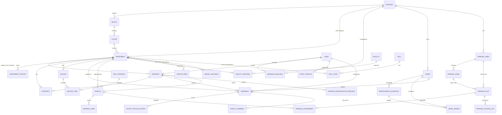
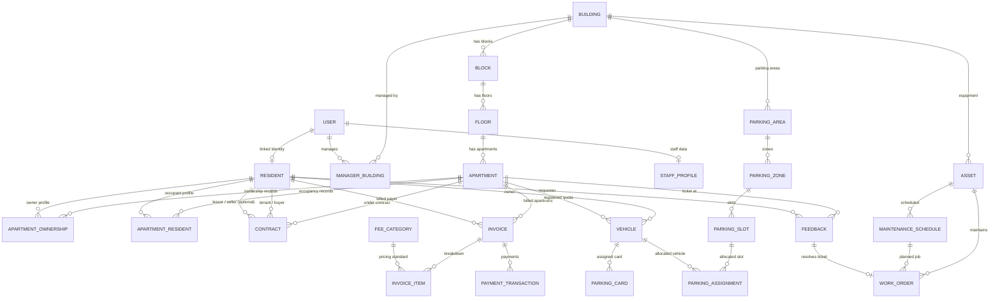

# K-HOME ENTITY RELATIONSHIP MAP (ERD & DOMAIN RELATIONSHIPS)

> **Tài liệu:** Bản đồ Quan hệ Thực thể & Sơ đồ ERD Toàn diện Hệ thống K-Home  
> **Dự án:** K-Home — Smart Property & Enterprise Apartment Management System  
> **Phiên bản:** 2.0 (Target Architecture)  
> **Ngày lập:** 12/10/2026  

---

## 1. SƠ ĐỒ ERD TỔNG THỂ HIỆN TẠI (AS-IS ARCHITECTURE)

Sơ đồ thể hiện cấu trúc database hiện tại trong `prisma/schema.prisma`:



---

## 2. SƠ ĐỒ ERD MỤC TIÊU ĐÃ CHUẨN HÓA (TO-BE ARCHITECTURE)

Sơ đồ đích khắc phục toàn bộ 14 vấn đề đã phát hiện:
1. **Phân tách hoàn toàn Quyền Sở Hữu (`ApartmentOwnership`) và Quyền Cư Trú (`ApartmentResident`).**
2. **Một người có thể sở hữu nhiều căn hộ, một căn hộ có thể có nhiều đồng sở hữu.**
3. **Chủ nhà không ở căn hộ (`Absent Owner`) và Người thuê (`Tenant`) cùng được quản lý song song.**
4. **Hóa đơn (`Invoice`) gắn trực tiếp với Căn hộ VÀ Người chịu trách nhiệm thanh toán (`payerResidentId`).**
5. **Bổ sung bảng `PaymentTransaction` lưu lịch sử thanh toán, hoàn tiền, thanh toán từng phần.**
6. **Loại bỏ trùng lặp phân cấp trong Bãi đỗ xe: `ParkingSlot` chỉ thuộc về `ParkingZone`.**
7. **Bảo toàn lịch sử phân công chỗ đỗ và bổ sung liên kết giữa `WorkOrder` và `Feedback`.**



---

## 3. BUSINESS RELATIONSHIP MAPS CHO TỪNG PHÂN HỆ NGHIỆP VỤ

### 3.1. Phân hệ Bất động sản Phân cấp (Property Hierarchy)

```
Building (ID, Code, Name)
  └── Block (ID, BuildingId, Code, Name)
        └── Floor (ID, BlockId, FloorNumber, Name)
              └── Apartment (ID, FloorId, Code, Area, Status)
```

* **Ràng buộc toàn vẹn:**
  * `Block` bắt buộc thuộc 1 `Building` (`onDelete: Cascade`).
  * `Floor` bắt buộc thuộc 1 `Block` (`onDelete: Cascade`).
  * `Apartment` bắt buộc thuộc 1 `Floor` (`onDelete: Restrict`).
  * Khóa tự nhiên Scoped: `@@unique([blockId, code])` hoặc `@@unique([buildingId, code])` trên `Apartment`.
  * Đường dẫn ngược truy vấn nhanh: `Apartment -> Floor -> Block -> Building` luôn đảm bảo tính nhất quán không mâu thuẫn.

---

### 3.2. Phân hệ Chủ sở hữu, Cư dân và Người thuê (Ownership & Residency)

```
                    ┌─────────────────────────┐
                    │          User           │ (Tài khoản, Mật khẩu, Vai trò)
                    └────────────┬────────────┘
                                 │ 1-1 (Optional)
                    ┌────────────▼────────────┐
                    │        Resident         │ (Nhân khẩu: Họ tên, CCCD, SĐT)
                    └───────┬──────────┬──────┘
                            │          │
         N-N (Sở hữu)       │          │ N-N (Cư trú)
    ┌───────────────────────▼──┐    ┌──▼───────────────────────┐
    │    ApartmentOwnership    │    │    ApartmentResident     │
    │ (Chủ hộ, Sổ đỏ, Tỷ lệ %) │    │ (Chủ ở, Khách thuê, Ở nhờ│
    └──────────────┬───────────┘    │  Bắt đầu -> Kết thúc)    │
                   │                └──┬───────────────────────┘
                   │                   │
                   └─────────┬─────────┘
                             │
                    ┌────────▼────────┐
                    │    Apartment    │ (Căn hộ)
                    └─────────────────┘
```

* **Quy tắc nghiệp vụ cốt lõi:**
  1. **User vs Resident:** `User` chỉ quản lý danh tính đăng nhập. Một `Resident` có thể chưa có `User` (VD: Người cao tuổi, trẻ nhỏ trong gia đình). Khi được cấp tài khoản, liên kết qua `Resident.userId`.
  2. **Quyền sở hữu (`ApartmentOwnership`):**
     * Một `Resident` có thể sở hữu $0, 1$ hoặc nhiều căn hộ (`investor`).
     * Một `Apartment` có thể có $1$ hoặc nhiều chủ sở hữu đồng sở hữu (`co-owners`), kèm trường `ownershipPercentage` (VD: 50% - 50%).
     * Lưu trữ `isCurrent: Boolean`, `startDate`, `endDate` để ghi nhận lịch sử chuyển nhượng nhà.
  3. **Quyền cư trú (`ApartmentResident`):**
     * Xác định ai thực sự đang sinh sống tại căn hộ (`isLivingHere = true`).
     * Phân loại vai trò cư trú qua enum: `HEAD_OF_HOUSEHOLD` (Chủ hộ), `FAMILY_MEMBER` (Thành viên), `TENANT` (Người thuê), `TEMPORARY` (Tạm trú).
     * Khi người thuê chuyển đi, hệ thống chỉ cần cập nhật `endDate = NOW()`, không làm ảnh hưởng đến hồ sơ nhân khẩu `Resident` hay hồ sơ sở hữu `ApartmentOwnership`.

---

### 3.3. Phân hệ Hợp đồng (Contracts)

```
Apartment (Căn hộ)
  └── Contract (ID, ContractCode, Type: RENT / SALE, Status)
        ├── Resident (Bên mua / Bên thuê)
        ├── Owner (Bên bán / Bên cho thuê - trỏ tới Resident là chủ sở hữu)
        └── Attachments (File hợp đồng PDF, Điều khoản thanh toán)
```

* **Quy tắc nghiệp vụ:**
  * Một căn hộ có thể có nhiều hợp đồng trong lịch sử, nhưng chỉ có **tối đa 1 hợp đồng RENT đang `ACTIVE`** hoặc **1 hợp đồng SALE đang `ACTIVE`** tại cùng một thời điểm.
  * Hợp đồng RENT liên thông với phân hệ Cư trú: Khi hợp đồng RENT được ký kết (`ACTIVE`), hệ thống tự động sinh bản ghi `ApartmentResident` với vai trò `TENANT`.

---

### 3.4. Phân hệ Phương tiện & Bãi đỗ xe thông minh (Parking Management)

```
Building
  └── ParkingArea (Hầm B1, Hầm B2)
        └── ParkingZone (Zone Ô tô, Zone Xe máy, Zone EV)
              └── ParkingSlot (Ô đỗ: B1-A01, B1-A02)
                    │
                    ├── ParkingAssignment (Phân công đang hiệu lực: Slot <-> Vehicle)
                    │     ├── Vehicle (Xe: Biển số, Loại xe)
                    │     │     ├── Resident (Chủ xe)
                    │     │     ├── Apartment (Hạn ngạch căn hộ)
                    │     │     └── ParkingCard (Thẻ từ RFID)
                    │     └── ParkingRegistrationRequest (Đơn đăng ký gốc)
                    │
                    └── ParkingAccessLog (Nhật ký ra vào cổng: Giờ vào/ra, Ảnh biển số)
```

* **Quy tắc nghiệp vụ:**
  * **Chuẩn hóa phân cấp:** `ParkingSlot` chỉ cần lưu `zoneId`. Thuộc tính `areaId` được suy ra từ `ParkingZone.areaId`.
  * **Chống đỗ xe trùng lặp (No Double-Booking):** Ràng buộc `ParkingAssignment` trạng thái `ACTIVE` trên cùng một `slotId` phải là duy nhất.
  * **Hạn ngạch phương tiện căn hộ:** Mỗi căn hộ có hạn ngạch xe tối đa (VD: 1 ô tô, 2 xe máy). Khi duyệt `ParkingRegistrationRequest`, hệ thống đếm số xe đang `ACTIVE` của căn hộ để kiểm soát.

---

### 3.5. Phân hệ Tài chính, Hóa đơn và Thanh toán (Financial & Payments)

```
Apartment (Căn hộ phát sinh phí)
  └── Invoice (Hóa đơn kỳ: Tháng, Hạn nộp, Tổng tiền)
        ├── Payer: Resident (Người chịu trách nhiệm nộp: Chủ nhà hoặc Người thuê)
        ├── InvoiceItems (Chi tiết: Phí QL, Phí Gửi xe, Tiền Nước, Dịch vụ)
        │     └── FeeCategory (Biểu phí chuẩn)
        └── PaymentTransactions (Lịch sử nộp tiền thực tế)
              ├── Amount (Số tiền giao dịch)
              ├── Method (VNPAY, MoMo, Chuyển khoản, Tiền mặt)
              ├── Status (SUCCESS, PENDING, FAILED)
              └── GatewayRef (Mã giao dịch ngân hàng / cổng thanh toán)
```

* **Quy tắc nghiệp vụ:**
  * **Nguyên tắc kế toán bất biến:** `Invoice` và `InvoiceItem` sau khi đã phát hành (`ISSUED`) không được tự ý sửa đơn giá.
  * **Thanh toán nhiều lần:** Một hóa đơn 10 triệu có thể được thanh toán qua 2 giao dịch: 4 triệu ngày mùng 5 và 6 triệu ngày mùng 10. Trạng thái hóa đơn chuyển từ `PARTIALLY_PAID` sang `PAID` khi tổng `PaymentTransaction.amount (SUCCESS) == Invoice.totalAmount`.
  * **Bảo toàn dữ liệu tài chính:** Khóa ngoại giữa `Invoice` và `Apartment` sử dụng `onDelete: Restrict`. Tuyệt đối không cho phép xóa căn hộ nếu đã có hóa đơn kế toán phát sinh.

---

### 3.6. Phân hệ Bảo trì, Tài sản và Sự cố (Maintenance & Assets)

```
Building
  └── Asset (Tài sản: Thang máy, Máy phát điện, Máy bơm)
        │
        ├── MaintenanceSchedule (Lịch bảo dưỡng định kỳ do BQL lập)
        │     └── WorkOrder (Phiếu việc kỹ thuật định kỳ)
        │
        └── Feedback (Phản ánh hỏng hóc từ Cư dân)
              └── WorkOrder (Phiếu việc kỹ thuật đột xuất khắc phục sự cố)
                    ├── AssignedStaff (Kỹ thuật viên phụ trách)
                    ├── Findings & Costs (Kết quả kiểm tra & Chi phí vật tư)
                    └── Status (IN_PROGRESS -> COMPLETED)
```

* **Quy tắc nghiệp vụ:**
  * Khi `WorkOrder` đột xuất (phát sinh từ `Feedback`) được kỹ thuật viên hoàn thành (`COMPLETED`), hệ thống kích hoạt trigger cập nhật `Feedback.status = RESOLVED` và gửi thông báo mời cư dân đánh giá sao (`Rating 1-5 sao`).
