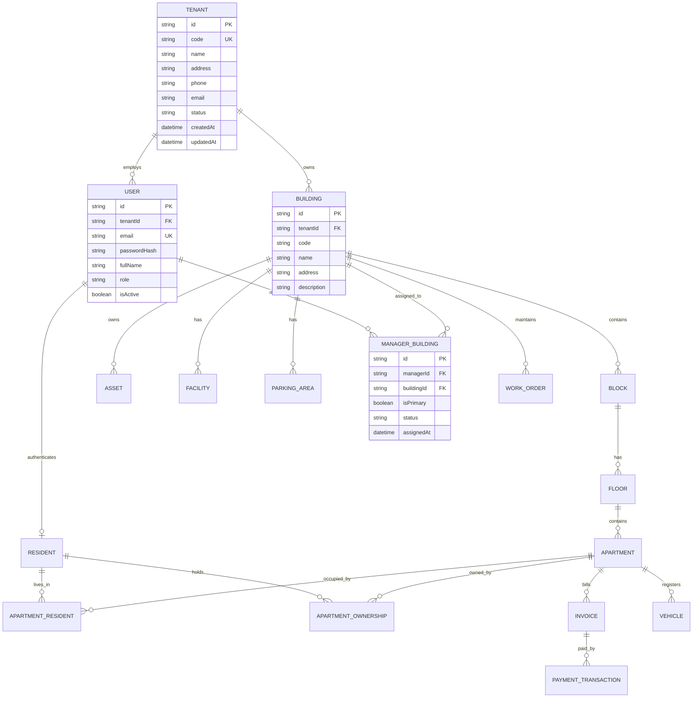

# K-HOME MULTI-TENANT ARCHITECTURE TARGET DESIGN SPECIFICATION
> **Tài liệu:** Thiết kế Kiến trúc Nghiệp vụ Đích Đa Khách Hàng (Target Multi-Tenant Design)  
> **Dự án:** K-Home — Enterprise Multi-Tenant Smart Living Platform  
> **Phiên bản:** 3.0  
> **Ngày lập:** 16/10/2026  
> **Tác giả:** Principal Software Architect & Senior Database Architect  

---

## 1. MÔ HÌNH NGHIỆP VỤ CỐT LÕI (CORE BUSINESS MODEL)

K-Home là nền tảng quản trị chung cư đa khách hàng (Multi-Tenant B2B SaaS).
* **Mỗi Khách hàng (Customer) là một Tenant** đại diện cho một tổ hợp chung cư hoặc một đơn vị vận hành bất động sản độc lập.
* **Mỗi Tenant** sở hữu một hoặc nhiều Tòa nhà (`Building`).
* **Tenant Admin** là tài khoản quản trị cấp cao nhất trong phạm vi Tenant đó, chịu trách nhiệm quản trị tòa nhà, cơ sở hạ tầng, tài chính, cư dân và phân công Manager.
* **Manager** là người quản lý vận hành được chỉ định vào các tòa nhà cụ thể thuộc Tenant. Manager chỉ có quyền truy cập dữ liệu của tòa nhà được phân công.
* **Platform Admin** là tài khoản vận hành cấp nền tảng của K-Home, quản lý danh sách khách hàng (Tenant), thiết lập cấu hình SaaS và khởi tạo tài khoản Tenant Admin ban đầu.

---

## 2. MA TRẬN VAI TRÒ & PHẠM VI TRUY CẬP (RBAC & SCOPE MATRIX)

```
┌─────────────────────────────────────────────────────────────────────────────┐
│                            PLATFORM ADMIN                                   │
│  (Quản trị toàn bộ nền tảng K-Home, Onboarding Khách hàng, Cấu hình SaaS)   │
└──────────────────────────────────────┬──────────────────────────────────────┘
                                       │ Quản lý & Cấp phát
                                       ▼
    ┌──────────────────────────────────┴──────────────────────────────────┐
    │                                                                     │
    ▼                                                                     ▼
┌─────────────────────────┐                           ┌─────────────────────────┐
│  TENANT A (SmartCity)   │                           │  TENANT B (Sunrise)     │
│  Tài khoản: TENANT_ADMIN│                           │  Tài khoản: TENANT_ADMIN│
├─────────────────────────┤                           ├─────────────────────────┤
│ • Building A1 (Sky)     │                           │ • Building B1 (Sunrise) │
│ • Building A2 (Ocean)   │                           │                         │
│ • Manager 1 -> Bldg A1  │                           │ • Manager 2 -> Bldg B1  │
│ • Staff & Cư dân A      │                           │ • Staff & Cư dân B      │
└─────────────────────────┘                           └─────────────────────────┘
```

### 2.1. Phân định quyền hạn chi tiết

| Vai trò (`Role`) | Phạm vi Dữ liệu (`Data Scope`) | Quyền hạn chính (`Capabilities`) | Điều cấm kỵ (`Strictly Forbidden`) |
| :--- | :--- | :--- | :--- |
| **`PLATFORM_ADMIN`** | **Toàn Nền Tảng (Global Platform)** | • Tạo & quản trị Tenant / Khách hàng.<br>• Kích hoạt / Tạm ngừng Tenant.<br>• Khởi tạo tài khoản Tenant Admin.<br>• Giám sát trạng thái hạ tầng hệ thống.<br>• Cấu hình các thiết lập cấp nền tảng. | • KHÔNG truy cập dữ liệu tài chính, hóa đơn, thông tin cá nhân cư dân của khách hàng khi không có lý do kỹ thuật.<br>• KHÔNG thao tác nhầm vào quy trình vận hành nội bộ của Tenant. |
| **`TENANT_ADMIN`** | **Toàn bộ Tenant hiện tại (`tenantId`)** | • Quản lý danh sách Building thuộc Tenant.<br>• Tạo và phân công Manager cho từng Building.<br>• Quản trị toàn bộ nhân sự (Staff) của Tenant.<br>• Quản trị Căn hộ, Cư dân, Hợp đồng, Hóa đơn toàn Tenant.<br>• Xem Dashboard & Báo cáo tổng hợp toàn Tenant. | • **TUYỆT ĐỐI KHÔNG** đọc/ghi dữ liệu của Tenant khác bằng cách đổi ID trên URL/API.<br>• KHÔNG tự cấp quyền `PLATFORM_ADMIN`.<br>• KHÔNG gán Manager vào Building của Tenant khác. |
| **`MANAGER`** | **Các Building được phân công (`assignedBuildingIds`)** | • Quản trị kỹ thuật, sự cố (`Feedback`, `Maintenance`).<br>• Quản lý bãi đỗ xe, thẻ xe, phương tiện trong tòa nhà.<br>• Quản lý khách thăm, bưu kiện, tiện ích trong tòa nhà.<br>• Xem cư dân và căn hộ thuộc tòa nhà được phân công.<br>• Lập hóa đơn và kiểm tra thu phí trong tòa nhà. | • KHÔNG truy cập tòa nhà ngoài danh sách phân công.<br>• KHÔNG tự phân công lại quyền quản lý.<br>• KHÔNG xem/sửa dữ liệu tòa nhà thuộc Tenant khác. |
| **`STAFF_*`** | **Bộ phận chuyên môn & Tòa nhà được phân công** | • Kỹ thuật (`STAFF_TECHNICIAN`): Xử lý ticket, lịch bảo trì.<br>• An ninh (`STAFF_SECURITY`): Quẹt thẻ xe, barrier, khách thăm.<br>• Lễ tân (`STAFF_RECEPTIONIST`): Tiếp nhận bưu kiện, cư dân. | • KHÔNG truy cập tài chính, hợp đồng pháp lý, cấu hình tòa nhà. |
| **`RESIDENT`** | **Phạm vi Căn hộ cư trú / sở hữu hợp lệ** | • Xem hồ sơ cá nhân và thành viên cùng căn hộ.<br>• Xem hóa đơn và thanh toán cho căn hộ của mình.<br>• Đăng ký xe, gửi sự cố, đặt tiện ích, đăng ký khách. | • KHÔNG xem thông tin căn hộ, xe, hóa đơn của cư dân khác.<br>• KHÔNG truy cập bất kỳ giao diện quản trị nào. |

---

## 3. THIẾT KẾ MÔ HÌNH DỮ LIỆU ĐÍCH (TARGET DATA MODEL & ERD)

### 3.1. Sơ đồ Quan hệ Thực thể (Mermaid ERD)



### 3.2. Cấu trúc Model Chi tiết

#### Model `Tenant`
```prisma
model Tenant {
  id          String        @id @default(cuid())
  code        String        @unique // e.g. "SMART-CITY-CORP", "SUNRISE-HOLDINGS"
  name        String        // Tên Khách hàng / Tổ hợp Chung cư
  address     String?
  phone       String?
  email       String?
  status      String        @default("ACTIVE") // ACTIVE, INACTIVE, SUSPENDED
  createdAt   DateTime      @default(now())
  updatedAt   DateTime      @updatedAt

  buildings   Building[]
  users       User[]

  @@map("tenants")
}
```

#### Cập nhật Model `Building`
```prisma
model Building {
  id          String      @id @default(cuid())
  tenantId    String?     // Nullable trong migration đầu, backfilled và liên kết Tenant
  tenant      Tenant?     @relation(fields: [tenantId], references: [id], onDelete: Cascade)
  code        String      @unique
  name        String
  address     String?
  description String?
  createdAt   DateTime    @default(now())
  updatedAt   DateTime    @updatedAt

  blocks        Block[]
  apartments    Apartment[]
  assets        Asset[]
  facilities    Facility[]
  managers      ManagerBuilding[] @relation("BuildingManagers")
  parkingAreas  ParkingArea[]

  @@index([tenantId])
  @@map("buildings")
}
```

#### Cập nhật Model `User`
```prisma
model User {
  id            String         @id @default(cuid())
  tenantId      String?        // Null cho PLATFORM_ADMIN, bắt buộc cho TENANT_ADMIN / MANAGER / STAFF
  tenant        Tenant?        @relation(fields: [tenantId], references: [id], onDelete: SetNull)
  email         String         @unique
  passwordHash  String
  fullName      String
  phone         String?
  avatarUrl     String?
  role          Role           @default(RESIDENT)
  isActive      Boolean        @default(true)
  createdAt     DateTime       @default(now())
  updatedAt     DateTime       @updatedAt

  // Relations ...
  managedBuildings ManagerBuilding[] @relation("ManagedBuildings")
  residentProfile  Resident?
  staffProfile     StaffProfile?

  @@index([tenantId])
  @@map("users")
}
```

#### Cập nhật Enum `Role`
```prisma
enum Role {
  PLATFORM_ADMIN
  TENANT_ADMIN
  ADMIN               // Giữ để backward-compatible
  MANAGER
  STAFF_TECHNICIAN
  STAFF_SECURITY
  STAFF_RECEPTIONIST
  RESIDENT
}
```

---

## 4. QUY TẮC QUẢN LÝ DATA SCOPE TRÊN TOÀN BỘ DOMAIN

Mọi truy vấn dữ liệu từ API hoặc Service bắt buộc tuân theo luồng xác thực 5 lớp:
1. **Authentication:** Request có JWT token hợp lệ không?
2. **Actor Scope Identification:**
   - Nếu là `PLATFORM_ADMIN`: Toàn quyền cấp nền tảng.
   - Nếu là `TENANT_ADMIN`: Bắt buộc gắn với `user.tenantId`.
   - Nếu là `MANAGER`: Bắt buộc gắn với `user.tenantId` VÀ `buildingId in assignedBuildingIds`.
   - Nếu là `STAFF_*`: Bắt buộc gắn với `user.tenantId` VÀ phạm vi ca trực/tòa nhà phân công.
   - Nếu là `RESIDENT`: Bắt buộc chỉ truy cập dữ liệu của chính mình (`residentId`) hoặc căn hộ được phân quyền (`apartmentId`).
3. **Target Scope Verification:** Entity mục tiêu (ví dụ Căn hộ, Hóa đơn, Thẻ xe) có thuộc đúng Tenant và Building đã xác thực không?
4. **Deny by Default:** Nếu resource không có liên kết hợp lệ hoặc nằm ngoài phạm vi, trả về ngay lập tức `403 Forbidden` (hoặc `404 Not Found` để chống thăm dò IDOR).

---

## 5. THIẾT KẾ TẦNG AUTHORIZATION DÙNG CHUNG

### 5.1. Session User Context (`src/lib/authorization.ts`)
```typescript
export interface SessionUser {
  id: string;
  role: Role | string;
  tenantId?: string | null;
  assignedBuildingIds?: string[];
  residentId?: string | null;
  apartmentId?: string | null;
  email?: string | null;
  name?: string | null;
}
```

### 5.2. Core Authorization Helpers
* `isPlatformAdmin(role)`: Trả về `true` nếu role là `PLATFORM_ADMIN`.
* `isTenantAdmin(role)`: Trả về `true` nếu role là `TENANT_ADMIN` (hoặc `ADMIN` trong giai đoạn chuyển đổi).
* `authorizeTenantAccess(user, targetTenantId)`:
  - Cho phép `PLATFORM_ADMIN`.
  - Với `TENANT_ADMIN`, `MANAGER`, `STAFF`: So khớp nghiêm ngặt `user.tenantId === targetTenantId`.
* `authorizeBuildingAccess(user, targetBuildingId)`:
  - Cho phép `PLATFORM_ADMIN`.
  - Với `TENANT_ADMIN`: Kiểm tra `building.tenantId === user.tenantId`.
  - Với `MANAGER`: Kiểm tra `building.tenantId === user.tenantId` VÀ `targetBuildingId in user.assignedBuildingIds`.

---

## 6. THIẾT KẾ TẦNG FRONTEND & NAVIGATION

### 6.1. Platform Admin Console (`/admin/tenants`)
- **Dashboard nền tảng:** Tổng số Tenant, số tổ hợp đang hoạt động, chỉ số người dùng toàn cầu.
- **Quản lý Khách hàng (Tenant Management):**
  - Danh sách Tenant, trạng thái (`ACTIVE`, `SUSPENDED`).
  - Form tạo Tenant mới và cấp phát tài khoản Tenant Admin ban đầu.
  - Cập nhật thông tin liên hệ và trạng thái vận hành.

### 6.2. Tenant Admin Dashboard (`/dashboard`)
- Header hiển thị rõ ràng: **"Tổ hợp: {tenant.name}"**.
- KPIs chỉ đếm các Building, Căn hộ, Cư dân, Doanh thu thuộc Tenant hiện tại.
- Dropdown `BuildingSwitcher` chỉ liệt kê các tòa nhà thuộc Tenant đó, không có tùy chọn xem toàn nền tảng.
- Form tạo và phân công Manager cho các tòa nhà trong Tenant.

### 6.3. Manager Dashboard
- Giao diện vận hành trực tiếp cho Building được giao.
- Nếu chỉ quản lý 1 Building: Khóa cứng không hiển thị selector.
- Nếu được phân công nhiều Building: Selector chỉ cho phép chuyển đổi giữa các Building được chỉ định thuộc cùng Tenant.
